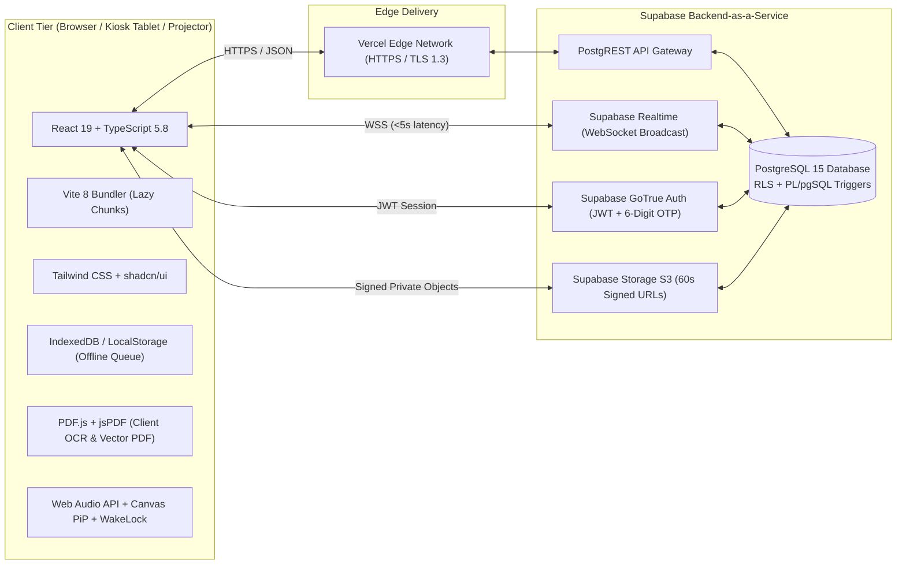
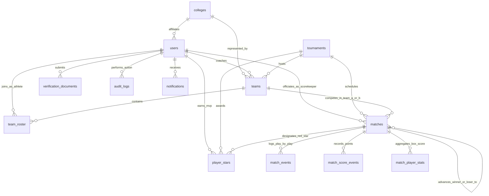

# PSU SportsTrack: The Complete Capstone Defense & Technical Master Guide

> **Capstone Project Title:** *PSU SportsTrack: A Web-Based Sports Tournament Management System for Palawan State University*  
> **Institution:** College of Sciences, Palawan State University (BS Information Technology)  
> **Proponents:** Jun Mark A. Brilliantes, Angelica B. Bande, Maverick Miguel A. Torres, Marco Rye S. Dela Serna, Charles Darwin G. Duerme  
> **Document Version:** Master Technical Reference (Synced with 292-Page Manuscript & Production Codebase)

---

## Table of Contents (One-Tap Navigation)

* [1. Executive System Overview & Domain Guardrails](#1-executive-system-overview--domain-guardrails)
  * [1.1 The 9 Official PSU Ballgame Disciplines](#11-the-9-official-psu-ballgame-disciplines)
  * [1.2 The 18 PSU Campuses & Dual Competition Structure](#12-the-18-psu-campuses--dual-competition-structure)
  * [1.3 The 7 User Classifications & Additive Dual-Role Architecture](#13-the-7-user-classifications--additive-dual-role-architecture)
  * [1.4 The 3-Phase Tournament Lifecycle](#14-the-3-phase-tournament-lifecycle)
* [2. Technology Stack & Dependency Justification Matrix](#2-technology-stack--dependency-justification-matrix)
  * [2.1 Core Architecture Stack (Why React + TypeScript + Vite + Supabase)](#21-core-architecture-stack-why-react--typescript--vite--supabase)
  * [2.2 Complete Production Dependencies Matrix (package.json)](#22-complete-production-dependencies-matrix-packagejson)
  * [2.3 Development & Testing Dependencies Matrix](#23-development--testing-dependencies-matrix)
* [3. System Architecture, Database Schema & End-to-End Lifecycles](#3-system-architecture-database-schema--end-to-end-lifecycles)
  * [3.1 Four-Layer Cloud Network Topology](#31-four-layer-cloud-network-topology)
  * [3.2 Complete Database Schema (11 ERD Entities + 3 Operational Tables)](#32-complete-database-schema-11-erd-entities--3-operational-tables)
  * [3.3 End-to-End Data Flow Lifecycles](#33-end-to-end-data-flow-lifecycles)
* [4. Appendix K Source Code Master Guide (Line-by-Line Breakdown)](#4-appendix-k-source-code-master-guide-line-by-line-breakdown)
  * [4.1 Snippet I.1: Hardened Match MVP Governance Validation](#41-snippet-i1-hardened-match-mvp-governance-validation)
  * [4.2 Snippet I.2: Scorekeeper Lease & Anti-Conflict of Interest (Anti-COI) Mechanism](#42-snippet-i2-scorekeeper-lease--anti-conflict-of-interest-anti-coi-mechanism)
  * [4.3 Snippet I.3: Database Row-Level Security (RLS) & Audit Triggers](#43-snippet-i3-database-row-level-security-rls--audit-triggers)
  * [4.4 Snippet I.4: Automated Bracket Generation Algorithm](#44-snippet-i4-automated-bracket-generation-algorithm)
  * [4.5 Snippet I.5: IndexedDB Offline Event Buffering & Atomic Sync](#45-snippet-i5-indexeddb-offline-event-buffering--atomic-sync)
  * [4.6 Snippet I.6: Certificate of Registration (COR) Confidence Scoring](#46-snippet-i6-certificate-of-registration-cor-confidence-scoring)
* [5. Deep-Dive: 4 Additional Core Production Engines](#5-deep-dive-4-additional-core-production-engines)
  * [5.1 Engine A: Dual-Path Auth, Brute-Force Lockout RPCs & Role Protection Trigger](#51-engine-a-dual-path-auth-brute-force-lockout-rpcs--role-protection-trigger)
  * [5.2 Engine B: Courtside Score Rollback, Compensating Deductions & Sport Rules Engine](#52-engine-b-courtside-score-rollback-compensating-deductions--sport-rules-engine)
  * [5.3 Engine C: Zero-Dependency Web Audio Synthesizer & Canvas Picture-in-Picture Stream](#53-engine-c-zero-dependency-web-audio-synthesizer--canvas-picture-in-picture-stream)
  * [5.4 Engine D: Multi-Page Vector Institutional Dossier PDF & UTF-8 CSV Engine](#54-engine-d-multi-page-vector-institutional-dossier-pdf--utf-8-csv-engine)
* [6. Complete Repository File-by-File Map & FR Traceability](#6-complete-repository-file-by-file-map--fr-traceability)
  * [6.1 Pages Directory (src/pages/)](#61-pages-directory-srcpages)
  * [6.2 Components Directory (src/components/)](#62-components-directory-srccomponents)
  * [6.3 Core Libraries & Engines (src/lib/)](#63-core-libraries--engines-srclib)
  * [6.4 Supabase Migrations Directory (supabase/migrations/)](#64-supabase-migrations-directory-supabasemigrations)
* [7. Anticipated Defense Panel Questions & Bulletproof Answers](#7-anticipated-defense-panel-questions--bulletproof-answers)
  * [7.1 Architecture & Stack Questions](#71-architecture--stack-questions)
  * [7.2 Security, RBAC & Privacy Questions](#72-security-rbac--privacy-questions)
  * [7.3 Courtside Scoring, Offline Sync & Anti-COI Questions](#73-courtside-scoring-offline-sync--anti-coi-questions)
  * [7.4 Bracket Mathematics, COR OCR & Scope Questions](#74-bracket-mathematics-cor-ocr--scope-questions)

---

## 1. Executive System Overview & Domain Guardrails

**PSU SportsTrack** is an enterprise-grade, mobile-first, cloud-native web application engineered specifically for the **Office of the Sports and Wellness Services (OSWS)** at **Palawan State University (PSU)**. It replaces fragmented, manual, paper-based intramural workflows with a unified digital ecosystem covering athlete registration, eligibility verification, coach-led squad formation, mathematical bracket engineering, offline-resilient courtside live scoring, anti-bias MVP governance, and one-click institutional compliance reporting.

### 1.1 The 9 Official PSU Ballgame Disciplines
The system is strictly scoped to **9 official Palawan State University ballgame disciplines**. Non-ballgame sports (e.g., swimming, athletics/track, chess, esports) are intentionally excluded at both the application layer ([`src/lib/sportIcons.ts`](file:///f:/VScodes/SportsTrack/psu-sportstrack/src/lib/sportIcons.ts), [`src/lib/sportScoringRules.ts`](file:///f:/VScodes/SportsTrack/psu-sportstrack/src/lib/sportScoringRules.ts)) and database layer.

| # | Ballgame Discipline | Scoring Unit | Period Structure | Key Scoring Actions (`sportScoringRules.ts`) | Bonus / Timeout Rules |
| :-: | :--- | :--- | :--- | :--- | :--- |
| **1** | **Basketball** | `PTS` | 4 Quarters + OT (`10m` default) | `+1 FT Made`, `+2 2PT Field Goal`, `+3 3PT Triple` | Team foul bonus at `5` fouls; `5` timeouts |
| **2** | **Volleyball** | `PTS` / Sets | Best of 3 or 5 Sets | `+1 Attack/Kill`, `+1 Service Ace`, `+1 Block Point`, `+1 Opponent Error` | `2` timeouts per set; rally scoring (25 pts, 15 in 5th) |
| **3** | **Soccer (Football)** | `GOALS` | 1st Half, 2nd Half, Extra Time, PK (`45m`) | `+1 Goal Scored`, `+1 Penalty Goal` | Halves clock control |
| **4** | **Futsal** | `GOALS` | 1st Half, 2nd Half, Extra Time, PK (`20m`) | `+1 Goal Scored`, `+1 Penalty Goal` | Accumulated foul penalty at `6` fouls; `1` timeout/half |
| **5** | **Sepak Takraw** | `PTS` / Regu Sets | Set 1, Set 2, Set 3 (Tie-Break) | `+1 Kill/Spike`, `+1 Service Ace`, `+1 Block`, `+1 Fault/Opponent Error` | `2` timeouts; 21-point set format |
| **6** | **Baseball** | `RUNS` | Innings 1–9 + Extra Innings | `+1 Single Run (RBI)`, `+2 2-Run Score`, `+3 3-Run Score`, `+4 Grand Slam` | Untimed inning progression |
| **7** | **Softball** | `RUNS` | Innings 1–7 + Extra Innings | `+1 Single Run`, `+2 2-Run Score`, `+3 3-Run Score`, `+4 Grand Slam` | Untimed 7-inning rule |
| **8** | **Pickleball** | `PTS` | Game 1, Game 2, Game 3 (Decider) | `+1 Rally/Winner`, `+1 Service Ace`, `+1 Opponent Fault` | 11-point win-by-2 format; `2` timeouts |
| **9** | **Table Tennis** | `PTS` | Game 1 through Game 5 | `+1 Winner/Smash`, `+1 Service Ace`, `+1 Opponent Edge/Net Error` | 11-point game format; `1` timeout |

### 1.2 The 18 PSU Campuses & Dual Competition Structure
Defined in [`src/lib/psuCampuses.ts`](file:///f:/VScodes/SportsTrack/psu-sportstrack/src/lib/psuCampuses.ts) and [`src/lib/collegeDictionary.ts`](file:///f:/VScodes/SportsTrack/psu-sportstrack/src/lib/collegeDictionary.ts):
* **18 Campuses Supported:** Main Campus (Puerto Princesa), Araceli, Balabac, Bataraza, Brooke's Point, Coron, Cuyo, Dumaran, El Nido, Linapacan, Narra, Quezon, Rizal, Roxas, San Rafael, San Vicente, Sofronio Española, and Taytay.
* **Two Official University Events:**
  1. **Binturungan (PSU Intramurals):** Annual student-athlete competition across PSU colleges (`CAH`, `CBA`, `CCJE`, `CCRD`, `CEAT`, `CHMT`, `CNHS`, `CS`, `CTE`, `LAW`, `GRAD`) and Binturungan Tribes/Clusters.
  2. **Faculty and Staff Friendly Games:** Annual employee competition structurally separated into **Faculty Athlete** and **Staff Athlete** divisions.

### 1.3 The 7 User Classifications & Additive Dual-Role Architecture
Defined in [`src/context/AuthContext.tsx`](file:///f:/VScodes/SportsTrack/psu-sportstrack/src/context/AuthContext.tsx) and [`supabase/migrations/20261010_unify_roles.sql`](file:///f:/VScodes/SportsTrack/psu-sportstrack/supabase/migrations/20261010_unify_roles.sql):

| # | User Classification | Database Role Key | Primary Capabilities & Restrictions |
| :-: | :--- | :--- | :--- |
| **1** | **Public Spectator** | *(Unauthenticated / `anon`)* | Views live matches, real-time play-by-play, brackets, medal standings, and scouting dossiers without logging in. |
| **2** | **Student Athlete** | `player_student` | Uploads digital PDF COR (`corParser.ts`), receives coach invites, views schedule, tracks personal stats & MVP stars. |
| **3** | **Faculty Athlete** | `player_faculty` | Uploads Employee ID for manual verification; competes in Faculty division of Friendly Games. |
| **4** | **Staff Athlete** | `player_staff` | Uploads Employee ID for manual verification; competes in Staff division of Friendly Games. |
| **5** | **Coach** | `coach` | Discovers verified athletes in their college, forms squads, claims tournament slots, assigns jerseys (`1–99`), starters, and captains. **Strictly read-only on live match scoring** to prevent coaching interference. |
| **6** | **Facilitator** | `facilitator` OR `is_facilitator = true` | Operates the courtside scoring kiosk (`/match/:matchId/kiosk`), claims 90s scorekeeper leases, manages clocks/subs, and nominates Red Star MVPs. Governed by automated **Anti-COI (Conflict of Interest)** checks. |
| **7** | **Administrator** | `super_admin` / `admin` | Full executive control: verifies documents, appoints facilitators, creates/launches tournaments, overrides scores/MVPs, restores soft-deleted records, and exports official FR-41/FR-43 PDF & CSV dossiers. |

> [!TIP]
> **Why Additive Dual-Role Architecture (`is_facilitator` boolean)?**  
> In university sports, many accredited courtside table officials are also verified student-athletes or faculty members competing in other events. Instead of forcing them to maintain two separate email accounts—or overwriting their primary `role` column and destroying their athlete profile—PSU SportsTrack uses an **additive union model** (`users.is_facilitator = true` alongside their base `role`). They retain their athlete/coach dashboard while gaining access to `/match/:matchId/kiosk`, while the **Anti-COI engine** blocks them from scoring any match involving their own college!

### 1.4 The 3-Phase Tournament Lifecycle
Every tournament created in [`src/pages/TournamentManagement.tsx`](file:///f:/VScodes/SportsTrack/psu-sportstrack/src/pages/TournamentManagement.tsx) transitions sequentially through three strict state gates:
1. **Phase 1: `Draft`** — Created by Admin; invisible to coaches; parameters and sport rules are configured.
2. **Phase 2: `Slotting`** — Opened by Admin with a target team slot cap (e.g., 8 teams) and registration deadline. Coaches build rosters and submit teams to claim slots; Admin reviews and approves/rejects teams.
3. **Phase 3: `Launched` (Ongoing -> Completed)** — Admin launches the bracket (Single Elimination, Double Elimination, Round Robin, or Hybrid Pool-to-Playoff). Rosters are locked by database trigger (`trg_guard_roster_lock`), fixtures are generated with `next_match_id` and `loser_next_match_id` pointers, and courtside scoring begins.

---

## 2. Technology Stack & Dependency Justification Matrix

### 2.1 Core Architecture Stack (Why React + TypeScript + Vite + Supabase)


* **Why React 19 + TypeScript 5.8?** Courtside scoring and live brackets involve deeply nested, high-frequency state updates (score counters, 1-second clocks, foul tallies, player box scores). React's declarative virtual DOM combined with TypeScript's compile-time type safety eliminates null-pointer crashes during live games.
* **Why Vite?** Delivers instantaneous Hot Module Replacement (HMR) during development and uses ESBuild/Rollup code splitting (`React.lazy` + `<Suspense>`) in production so heavy libraries like `pdfjs-dist` and `jspdf` are never downloaded by public spectators on initial page load.
* **Why Supabase (PostgreSQL 15)?** Tournament brackets, team rosters, and player statistics are **inherently relational** (requiring foreign keys, ACID transactions, and cascading updates). Unlike NoSQL document stores (Firebase Firestore), Supabase provides a full relational PostgreSQL engine with **Row-Level Security (RLS)**, **PL/pgSQL triggers** for automated bracket progression and tamper-proof audit logging, and native **WebSocket Realtime** replication over `postgres_changes`.

### 2.2 Complete Production Dependencies Matrix (`package.json`)
Every library in [`package.json`](file:///f:/VScodes/SportsTrack/psu-sportstrack/package.json) serves a specific, justifiable architectural purpose:

| Library / Package | Version | Where It Is Used in the Codebase | Technical Role & Why It Was Chosen |
| :--- | :---: | :--- | :--- |
| **`react` & `react-dom`** | `^19.2.4` | Entire `src/` UI tree | Core component rendering engine, concurrent hooks (`useMemo`, `useCallback`, `useEffect`), and lazy route suspense boundaries. |
| **`react-router-dom`** | `^7.13.1` | [`src/App.tsx`](file:///f:/VScodes/SportsTrack/psu-sportstrack/src/App.tsx), [`ProtectedRoute.tsx`](file:///f:/VScodes/SportsTrack/psu-sportstrack/src/components/ProtectedRoute.tsx) | Client-side SPA routing, dynamic URL parameters (`/match/:matchId/kiosk`), and role-gated route protection without full-page reloads. |
| **`@supabase/supabase-js`** | `^2.99.1` | [`src/lib/supabase.ts`](file:///f:/VScodes/SportsTrack/psu-sportstrack/src/lib/supabase.ts), all pages | Isomorphic client for PostgreSQL queries, RPC invocations, GoTrue JWT authentication, S3 storage uploads, and Realtime WebSocket subscriptions. |
| **`pdfjs-dist`** | `^5.6.205` | [`src/lib/corParser.ts`](file:///f:/VScodes/SportsTrack/psu-sportstrack/src/lib/corParser.ts), [`CanvasPdfViewer.tsx`](file:///f:/VScodes/SportsTrack/psu-sportstrack/src/components/admin/CanvasPdfViewer.tsx) | Mozilla's PDF engine. Used (1) to extract digital text layers client-side from Student COR PDFs for the 0–100 OCR confidence score, and (2) to render zoomable PDF canvases in the Admin Verification console without browser iframe blocking. |
| **`jspdf` & `jspdf-autotable`** | `^4.2.1` / `^5.0.7` | [`src/lib/pdfReportGenerator.ts`](file:///f:/VScodes/SportsTrack/psu-sportstrack/src/lib/pdfReportGenerator.ts) | Generates print-ready, multi-page **Vector A4 Landscape Institutional Dossiers (FR-41/FR-43)** with crisp typography, university branding headers, and paginated tables directly in the browser. |
| **`react-hook-form` & `@hookform/resolvers`** | `^7.71.2` / `^5.2.2` | [`Register.tsx`](file:///f:/VScodes/SportsTrack/psu-sportstrack/src/pages/Register.tsx), [`LoginModal.tsx`](file:///f:/VScodes/SportsTrack/psu-sportstrack/src/components/auth/LoginModal.tsx) | Uncontrolled form state management that prevents unnecessary re-renders on every keystroke while binding directly to Zod validation schemas. |
| **`zod`** | `^4.3.6` | [`Register.tsx`](file:///f:/VScodes/SportsTrack/psu-sportstrack/src/pages/Register.tsx), [`passwordPolicy.ts`](file:///f:/VScodes/SportsTrack/psu-sportstrack/src/lib/passwordPolicy.ts) | Runtime schema validation enforcing `@psu.palawan.edu.ph` corporate email rules, student ID formats, and password complexity before any network request leaves the client. |
| **`lucide-react` & `react-icons`** | `^0.577.0` / `^5.6.0` | [`src/lib/sportIcons.ts`](file:///f:/VScodes/SportsTrack/psu-sportstrack/src/lib/sportIcons.ts), UI controls | `react-icons/gi` provides authentic vector silhouettes for the 9 PSU ballgames (`GiBasketballBall`, `GiVolleyballBall`, `GiSoccerKick`, etc.); `lucide-react` provides clean administrative and HUD iconography. |
| **`@radix-ui/*` & `shadcn`** | `^1.4.3` / `^4.0.5` | `src/components/ui/*` | Accessible, WAI-ARIA compliant headless primitives (Dialogs, Select dropdowns, Tabs, Checkboxes) styled with Tailwind CSS. |
| **`tailwind-merge`, `clsx`, `class-variance-authority`** | `^3.5.0` / `^2.1.1` / `^0.7.1` | [`src/lib/utils.ts`](file:///f:/VScodes/SportsTrack/psu-sportstrack/src/lib/utils.ts) (`cn()` helper) | Deterministically merges conditional Tailwind utility classes without CSS specificity collisions. |
| **`next-themes`** | `^0.4.6` | [`ThemeProvider.tsx`](file:///f:/VScodes/SportsTrack/psu-sportstrack/src/context/ThemeProvider.tsx), [`ThemeToggle.tsx`](file:///f:/VScodes/SportsTrack/psu-sportstrack/src/components/ui/ThemeToggle.tsx) | Synchronizes Light Mode (for outdoor sunlit courtside tablets) and Dark Mode (for indoor gymnasiums and Jumbotron projectors) with `localStorage` and system preferences. |
| **`sonner`** | `^2.0.7` | [`src/components/ui/sonner.tsx`](file:///f:/VScodes/SportsTrack/psu-sportstrack/src/components/ui/sonner.tsx) | Non-blocking toast notification stack for real-time score feedback, offline sync alerts, and error reporting. |
| **`qrcode`** | `^1.5.4` | Quick-share match links | Generates scannable QR codes so spectators in the gym bleachers can scan a screen and jump straight into `/match/:matchId`. |

### 2.3 Development & Testing Dependencies Matrix
* **`@playwright/test` (`^1.58.2`):** End-to-end headless browser automation testing across Chromium desktop (`1440×900`, `1920×1080`) and mobile (`320×568`, `375×667`, `390×844`) viewports, verifying anti-truncation rules, RBAC routing, and automated screenshot generation (`tests/`).
* **`typescript` (`~5.8.3`) & `vite` (`^8.0.0`):** Strict static type-checking (`tsc -b`) and production bundle optimization.

---

## 3. System Architecture, Database Schema & End-to-End Lifecycles

### 3.1 Four-Layer Cloud Network Topology
As illustrated in Chapter 4 (Page 125 of the manuscript):
1. **WAN / Connectivity Layer:** Campus Wi-Fi access points across all 18 PSU campuses or 4G/5G mobile hotspots (with automatic offline failover for courtside tablets).
2. **Client Layer:**
   - **Spectator & Athlete Devices:** Smartphones/laptops viewing live scores, brackets, and profiles.
   - **Courtside Facilitator Tablet:** Running `/match/:matchId/kiosk` with IndexedDB/localStorage offline event queue.
   - **Stadium Display Unit:** Mini-PC/laptop connected via HDMI to the gymnasium projector and PA audio system (`/match/:matchId/display`), using the browser **Screen Wake Lock API** and **Web Audio API**.
   - **Admin Workstation:** Running `/admin` for document verification, bracket seeding, and PDF/CSV dossier generation.
3. **Edge Layer:** Redundant firewall + **Vercel Edge Network** terminating SSL/TLS 1.3 and serving code-split static SPA bundles from the nearest CDN node.
4. **Backend Layer (Supabase Cloud):**
   - **GoTrue Auth Service:** Issues short-lived JWT access tokens and handles 6-digit OTP & magic-link verification.
   - **PostgREST API Gateway:** Translates client SDK queries directly into parameterized SQL statements checked against RLS policies.
   - **PostgreSQL 15 Engine:** Executes ACID transactions, foreign key checks, and PL/pgSQL triggers.
   - **Supabase Realtime Engine:** Tails the PostgreSQL Write-Ahead Log (WAL) and broadcasts row mutations over WebSockets in `< 500ms`.
   - **Object Storage (S3):** Holds private verification documents partitioned by `auth.uid()` folder prefixes and served exclusively via **60-second expiring signed URLs**.

### 3.2 Complete Database Schema (11 ERD Entities + 3 Operational Tables)



| # | Table Name | Category | Primary Key & Key Foreign Keys | Core Purpose & Security Invariants |
| :-: | :--- | :--- | :--- | :--- |
| **1** | **`users`** | Core ERD | `id` (FK -> `auth.users`), `college_id`, `cluster_id` | Central user directory storing `role`, `is_facilitator`, `is_verified`, `campus`, `student_number`, `year_level` (`INT`), `sports_interests`, and `deleted_at`. Protected by `trg_protect_user_roles`. |
| **2** | **`colleges`** | Core ERD | `id` | Stores official PSU colleges (`college_name`, `code`, `color_theme`) and medal tallies (`gold_medals`, `silver_medals`, `bronze_medals`, `points`). |
| **3** | **`verification_documents`** | Core ERD | `id`, `user_id` (FK -> `users.id`) | Tracks uploaded COR PDFs and Employee IDs, storing `file_url`, `ocr_confidence_score` (`0–100`), `status` (`Pending`, `Approved`, `Rejected`), and `admin_notes`. |
| **4** | **`tournaments`** | Core ERD | `id`, `created_by` (FK -> `users.id`) | Tournament containers with `name`, `sport` (strictly 9 ballgames), `event_type` (`Binturungan` / `Friendly Games`), `division`, `status` (`Draft`, `Slotting`, `Ongoing`, `Completed`), `max_teams`, and `deleted_at`. |
| **5** | **`teams`** | Core ERD | `id`, `tournament_id`, `coach_id`, `college_id` | Squad registrations with `name`, `status` (`Pending`, `Approved`, `Rejected`), `affiliation_type`, and `deleted_at`. |
| **6** | **`team_roster`** | Core ERD | `id`, `team_id`, `player_id` | Junction table linking athletes to squads with `jersey_number` (`1–99`), `position`, `is_captain`, `is_starter`, `availability_status` (`Active`, `Injured`, `Excused`), and `status` (`Pending`, `Approved`, `Rejected`). |
| **7** | **`matches`** | Core ERD | `id`, `tournament_id`, `team_a_id`, `team_b_id`, `winner_team_id`, `active_scorekeeper_id`, `next_match_id`, `loser_next_match_id` | Individual game fixtures storing live scores (`team_a_score`, `team_b_score`), clock state (`game_time_seconds`, `current_period`, `is_clock_running`), foul/timeout counters, lease timestamp (`lease_expires_at`), and bracket progression pointers. |
| **8** | **`match_events`** | Core ERD | `id`, `match_id` | Chronological play-by-play text feed (`description`, `created_at`) for timeouts, substitutions, period transitions, and commentary. |
| **9** | **`match_score_events`** | Core ERD | `id`, `match_id`, `team_id`, `player_id` | Immutable scoring ledger recording every point attribution (`points`, `delta`, `action_type`, `stat_type`, and rollback flag `undone = true/false`). |
| **10** | **`player_stars`** | Core ERD | `id`, `player_id`, `match_id`, `tournament_id`, `awarded_by`, `overridden_by` | Stores **Gold Star** (Tournament MVP), **Red Star** (Match MVP), and **Yellow Star** awards, along with anti-bias `justification` and admin `override_reason`. |
| **11** | **`audit_logs`** | Core ERD | `id`, `actor_id`, `admin_id` | Immutable security ledger logging administrative actions, score overrides, document approvals, and MVP revocations with JSON before/after diffs. |
| **12** | **`notifications`** | Operational | `id`, `user_id` (FK -> `users.id`) | Real-time in-app notification inbox (FR-08) delivering instant approval/rejection feedback and team invitation alerts (`NotificationBell.tsx`). |
| **13** | **`rate_limit_attempts`** | Operational | `email` | Tracks consecutive failed login attempts and 15-minute lockout windows for brute-force protection RPCs (FR-04). |
| **14** | **`match_player_stats`** | Operational | `id`, `match_id`, `player_id`, `team_id` | Pre-aggregated per-match athlete point totals (`points`, `jersey_number`) enabling instant box-score rendering and O(1) point rollback compensation. |

### 3.3 End-to-End Data Flow Lifecycles

#### Lifecycle 1: Student Athlete Registration & Client-Side COR Verification (FR-04, FR-06, FR-07, FR-08, FR-31)
1. **Sign-Up & Trigger Sync:** Student fills out [`Register.tsx`](file:///f:/VScodes/SportsTrack/psu-sportstrack/src/pages/Register.tsx) with their `@psu.palawan.edu.ph` email. Supabase Auth sends a **6-digit OTP** and magic link. Upon verification in [`OtpVerificationStep.tsx`](file:///f:/VScodes/SportsTrack/psu-sportstrack/src/components/auth/OtpVerificationStep.tsx), PostgreSQL trigger `handle_new_user` creates their `public.users` row with `is_verified = false`.
2. **Client-Side PDF Extraction:** Student uploads their digital PSU COR PDF in [`VerificationUpload.tsx`](file:///f:/VScodes/SportsTrack/psu-sportstrack/src/components/auth/VerificationUpload.tsx). Before uploading to storage, [`corParser.ts`](file:///f:/VScodes/SportsTrack/psu-sportstrack/src/lib/corParser.ts) runs `pdfjs-dist` in a Web Worker, extracts the text layer, and computes a **0–100 advisory confidence score** across 5 pillars (Student ID match, Fuzzy Name similarity, College match, PSU Email domain, and Official PSU COR headers).
3. **Partitioned Storage Upload:** The PDF is uploaded to `storage.objects` under path `<user_id>/<timestamp>_cor.pdf` (enforced by Storage RLS) and recorded in `verification_documents`.
4. **Admin Review & Notification:** Admin opens [`SystemVerifications.tsx`](file:///f:/VScodes/SportsTrack/psu-sportstrack/src/pages/SystemVerifications.tsx), inspects the PDF via a **60-second signed URL** inside [`CanvasPdfViewer.tsx`](file:///f:/VScodes/SportsTrack/psu-sportstrack/src/components/admin/CanvasPdfViewer.tsx), cross-checks the OCR breakdown against the PSU AIMS portal link, and clicks **Approve**. This updates `users.is_verified = true`, logs an entry in `audit_logs`, and inserts an alert into `notifications`.

#### Lifecycle 2: Live Courtside Scoring, Offline Failover & Real-Time Broadcast (FR-19 to FR-28, FR-44 to FR-46)
1. **Anti-COI & Lease Acquisition:** Facilitator opens `/match/:matchId/kiosk` ([`FacilitatorKiosk.tsx`](file:///f:/VScodes/SportsTrack/psu-sportstrack/src/pages/FacilitatorKiosk.tsx)). The system checks that the facilitator's `college_id` does not match either competing team. If clear, it sets `matches.active_scorekeeper_id` and starts a 15-second heartbeat extending a 90-second lease. Match metadata and rosters are immediately cached via `offlineQueue.cacheMatchContext()`.
2. **Scoring Attribution:** Facilitator taps `+3 3PT Triple` and selects Jersey `#7` in [`KioskScoreCreditModal.tsx`](file:///f:/VScodes/SportsTrack/psu-sportstrack/src/components/kiosk/KioskScoreCreditModal.tsx).
   - **If Online:** Writes to `matches` (total score), `match_score_events` (ledger), `match_player_stats` (box score), and `match_events` (play-by-play text). Supabase Realtime broadcasts the change in `<500ms` to all spectators on [`LiveMatch.tsx`](file:///f:/VScodes/SportsTrack/psu-sportstrack/src/pages/LiveMatch.tsx), the floating PiP window ([`pipScoreboard.ts`](file:///f:/VScodes/SportsTrack/psu-sportstrack/src/lib/pipScoreboard.ts)), and the gym projector ([`StadiumDisplay.tsx`](file:///f:/VScodes/SportsTrack/psu-sportstrack/src/pages/StadiumDisplay.tsx)), triggering a 4-tone synthesized arpeggio chime via [`audioFx.ts`](file:///f:/VScodes/SportsTrack/psu-sportstrack/src/lib/audioFx.ts).
   - **If Offline:** `offlineQueue.bufferScoreEvent()` stores the event locally in browser storage and updates the kiosk UI optimistically. The moment Wi-Fi returns, the `window.addEventListener('online')` listener invokes `offlineQueue.flush()` (`sync_offline_match_events` RPC) to atomically commit all buffered events in chronological order.

---

## 4. Appendix K Source Code Master Guide (Line-by-Line Breakdown)

This section provides an exhaustive, line-by-line explanation of all **six code excerpts included in Appendix K (Pages 264–283)** of the capstone manuscript, mapping each snippet to its exact file in the project repository and explaining **what** every statement does, **how** it works under the hood, and **why** it was architected that way.

---

### 4.1 Snippet I.1: Hardened Match MVP Governance Validation
* **Manuscript Location:** Appendix K, Section `I.1` (Pages 264–265)
* **Live Codebase Files:**
  * [`src/components/match/MvpAttestationModal.tsx` (Lines 17–52)](file:///f:/VScodes/SportsTrack/psu-sportstrack/src/components/match/MvpAttestationModal.tsx#L17-L52)
  * [`src/pages/FacilitatorKiosk.tsx` (Lines 1225–1280)](file:///f:/VScodes/SportsTrack/psu-sportstrack/src/pages/FacilitatorKiosk.tsx#L1225-L1280)
* **Functional Requirements Satisfied:** `FR-28`, `FR-48` (Match MVP Anti-Bias Governance), `FR-49` (Anomalous MVP Nomination Justification)

#### Exact Manuscript Snippet (`I.1`)
```typescript
import { useState, useMemo } from 'react';

export interface MvpCandidate {
  id: string;
  name: string;
  points: number;
  isWinningTeam: boolean;
  collegeId?: string;
}

// 1. State hooks for attestation acknowledgement and justification input
const [justification, setJustification] = useState<string>('');
const [hasAttested, setHasAttested] = useState<boolean>(false);

// 2. Dynamically flag athletes with 0 recorded points or from the losing squad
const isLosingTeamOrZeroStats = useMemo(() => {
  if (!candidate) return false;
  return !candidate.isWinningTeam || candidate.points === 0;
}, [candidate]);

// 3. Justification validation gate (enforces minimum 10 characters when condition is triggered)
const isJustificationValid = useMemo(() => {
  if (!isLosingTeamOrZeroStats) return true;
  return justification.trim().length >= 10;
}, [isLosingTeamOrZeroStats, justification]);

// 4. Governance gate: Disables 'Commit Award' action until mandatory conditions are satisfied
const canCommitAward = Boolean(
  hasAttested &&
  isJustificationValid &&
  !isSubmitting
);
```

#### Line-by-Line Anatomical Breakdown

| Lines | Code Statement | What It Does | How It Works & Why We Used It |
| :--- | :--- | :--- | :--- |
| **1** | `import { useState, useMemo } from 'react';` | Imports React's core state and memoization hooks. | `useState` tracks interactive form inputs inside the modal; `useMemo` caches derived boolean flags so validation logic only recalculates when dependencies change. |
| **3–9** | `export interface MvpCandidate { id: string; name: string; points: number; isWinningTeam: boolean; collegeId?: string; }` | Defines the TypeScript contract for any athlete nominated for the Red Star (Match MVP). | Combines identity (`id`, `name`), aggregated offensive production from `match_player_stats` (`points`), match outcome context (`isWinningTeam`), and optional `collegeId` for Conflict-of-Interest checks. |
| **12** | `const [justification, setJustification] = useState<string>('');` | Initializes controlled state for the written explanation textarea. | Starts as an empty string `''`. Updated on every keystroke when a facilitator types a reason for an unusual MVP selection. |
| **13** | `const [hasAttested, setHasAttested] = useState<boolean>(false);` | Tracks whether the facilitator has checked the mandatory *Fair Play & Neutrality Attestation* checkbox. | Defaults to `false`, forcing an explicit, conscious legal/ethical opt-in before any MVP award can be saved. |
| **16–19** | `const isLosingTeamOrZeroStats = useMemo(() => { if (!candidate) return false; return !candidate.isWinningTeam || candidate.points === 0; }, [candidate]);` | Detects whether the selected MVP nominee is "anomalous" (either from the losing team or has `0` recorded points). | **Why?** In sports like soccer or basketball, a defensive anchor or goalkeeper might win MVP with `0` offensive points, or a player on the losing team might score 50 points. Rather than hard-blocking these legitimate edge cases, the system flags them (`true`) so a written justification is required! |
| **22–25** | `const isJustificationValid = useMemo(() => { if (!isLosingTeamOrZeroStats) return true; return justification.trim().length >= 10; }, [isLosingTeamOrZeroStats, justification]);` | Enforces the **10-character minimum justification rule (`FR-49`)** when an anomalous candidate is selected. | **How it works:** If `isLosingTeamOrZeroStats` is `false` (normal winner with >0 pts), validation automatically passes (`return true`). If `true`, `.trim()` strips leading/trailing whitespace (preventing facilitators from bypassing the rule by typing 10 spaces `"          "`) and checks `.length >= 10`. |
| **28–32** | `const canCommitAward = Boolean(hasAttested && isJustificationValid && !isSubmitting);` | Final boolean gate controlling the `disabled` prop of the **"Commit Red Star Award"** button. | **Why all three?** (1) `hasAttested`: ensures ethical sign-off; (2) `isJustificationValid`: ensures anomalous picks are explained for the audit log; (3) `!isSubmitting`: prevents double-click race conditions while the database `INSERT` is in flight. |

---

### 4.2 Snippet I.2: Scorekeeper Lease & Anti-Conflict of Interest (Anti-COI) Mechanism
* **Manuscript Location:** Appendix K, Section `I.2` (Pages 265–268)
* **Live Codebase Files:**
  * [`src/pages/FacilitatorKiosk.tsx` (Lines 280–420)](file:///f:/VScodes/SportsTrack/psu-sportstrack/src/pages/FacilitatorKiosk.tsx#L280-L420)
  * [`supabase/migrations/20261030_harden_facilitator_role_and_governance.sql`](file:///f:/VScodes/SportsTrack/psu-sportstrack/supabase/migrations/20261030_harden_facilitator_role_and_governance.sql)
* **Functional Requirements Satisfied:** `FR-11` (Dual-Role Anti-COI), `FR-19` (Scorekeeper Lease), `FR-20` (Lease Transfer)

#### Exact Manuscript Snippet (`I.2`)
```typescript
import { supabase } from '@/lib/supabase';

export interface AntiCoiCheckResult {
  allowed: boolean;
  hasConflict: boolean;
  reason?: string;
}

/**
 * 1. Anti-COI Governance: Compares facilitator's collegiate affiliation
 * against Home and Away teams. Denies scoring console access on match.
 */
export function checkFacilitatorAntiCoi(
  facilitatorCollegeId: string | null | undefined,
  homeTeamCollegeId: string | null | undefined,
  awayTeamCollegeId: string | null | undefined
): AntiCoiCheckResult {
  if (!facilitatorCollegeId) {
    return { allowed: true, hasConflict: false };
  }
  if (facilitatorCollegeId === homeTeamCollegeId) {
    return {
      allowed: false,
      hasConflict: true,
      reason: 'Conflict of Interest: Facilitator belongs to the same college as the Home Team.',
    };
  }
  if (facilitatorCollegeId === awayTeamCollegeId) {
    return {
      allowed: false,
      hasConflict: true,
      reason: 'Conflict of Interest: Facilitator belongs to the same college as the Away Team.',
    };
  }
  return { allowed: true, hasConflict: false };
}

/**
 * 2. Claims the active scorekeeper lease for 90 seconds in the database
 * subject to the Anti-COI gate.
 */
export async function claimScorekeeperLease(
  matchId: string,
  facilitatorId: string,
  facilitatorCollegeId: string | null | undefined,
  homeTeamCollegeId: string | null | undefined,
  awayTeamCollegeId: string | null | undefined
): Promise<{ success: boolean; error?: string }> {
  // Execute Anti-COI verification prior to claiming lease
  const coi = checkFacilitatorAntiCoi(facilitatorCollegeId, homeTeamCollegeId, awayTeamCollegeId);
  if (!coi.allowed) {
    return { success: false, error: coi.reason };
  }

  const leaseExpiresAt = new Date(Date.now() + 90 * 1000).toISOString();
  const { error } = await supabase
    .from('matches')
    .update({
      active_scorekeeper_id: facilitatorId,
      lease_expires_at: leaseExpiresAt,
    })
    .eq('id', matchId);

  if (error) {
    return { success: false, error: error.message };
  }
  return { success: true };
}

/**
 * 3. Heartbeat timer: Pings the database every 15 seconds to extend the
 * 90-second scorekeeper lease window while the session is live.
 * Returns a teardown function to clear the interval.
 */
export function startHeartbeat(
  matchId: string,
  facilitatorId: string,
  onHeartbeatFailure?: (error: unknown) => void
): () => void {
  const PING_INTERVAL_MS = 15 * 1000; // 15 seconds
  const LEASE_DURATION_MS = 90 * 1000; // 90 seconds

  const intervalId = setInterval(async () => {
    try {
      const leaseExpiresAt = new Date(Date.now() + LEASE_DURATION_MS).toISOString();
      const { error } = await supabase
        .from('matches')
        .update({
          active_scorekeeper_id: facilitatorId,
          lease_expires_at: leaseExpiresAt,
        })
        .eq('id', matchId);

      if (error) throw error;
    } catch (err) {
      if (onHeartbeatFailure) {
        onHeartbeatFailure(err);
      }
      console.warn('[Scorekeeper Lease Heartbeat] Failed to extend lease:', err);
    }
  }, PING_INTERVAL_MS);

  return () => clearInterval(intervalId);
}
```

#### Line-by-Line Anatomical Breakdown

| Function / Block | Code Lines & Logic | How It Works & Architectural Rationale |
| :--- | :--- | :--- |
| **`checkFacilitatorAntiCoi`** | Compares `facilitatorCollegeId` against `homeTeamCollegeId` and `awayTeamCollegeId`. | **Why?** Because PSU SportsTrack allows student-athletes and faculty to hold dual-role Facilitator privileges (`FR-11`), a CEAT student facilitator could otherwise open a CEAT vs. CS basketball game and manipulate scores. If `facilitatorCollegeId` matches either team's `college_id`, the function returns `{ allowed: false, hasConflict: true }` with an explicit human-readable reason. Neutral officials (where `facilitatorCollegeId` is `null`) bypass the check (`allowed: true`). |
| **`claimScorekeeperLease`** | Calls `checkFacilitatorAntiCoi()` first; if allowed, computes `new Date(Date.now() + 90 * 1000).toISOString()` and updates `matches.active_scorekeeper_id` and `lease_expires_at`. | **Why a 90-second expiring lease (`FR-19`)?** In a live gymnasium, if two facilitators accidentally open the same match on two tablets, simultaneous score taps would corrupt the score. By writing `active_scorekeeper_id` with a 90-second TTL (`lease_expires_at`), only ONE device holds write authority at any moment. If the tablet battery dies or closes unexpectedly, the lock automatically expires after 90 seconds so a backup official can take over without needing an Admin reset! |
| **`startHeartbeat`** | Sets `PING_INTERVAL_MS = 15000` (15s) and `LEASE_DURATION_MS = 90000` (90s), running `setInterval` to push `lease_expires_at` forward by 90s every 15s. Returns `() => clearInterval(intervalId)`. | **Why 15s ping / 90s lease ratio (6:1 buffer)?** Gymnasium Wi-Fi can experience brief packet loss. By pinging every 15 seconds while holding a 90-second lease, a facilitator's tablet can survive up to **5 consecutive missed network pings (75 seconds of lag)** without losing its active scorekeeper lock! Returning `() => clearInterval(intervalId)` allows React's `useEffect` cleanup to immediately stop the timer when the facilitator exits the kiosk. |

---

### 4.3 Snippet I.3: Database Row-Level Security (RLS) & Audit Triggers
* **Manuscript Location:** Appendix K, Section `I.3` (Pages 268–272)
* **Live Codebase Files:**
  * [`supabase/migrations/20261031_harden_mvp_star_governance.sql` (Lines 1–51)](file:///f:/VScodes/SportsTrack/psu-sportstrack/supabase/migrations/20261031_harden_mvp_star_governance.sql#L1-L51)
  * [`supabase/migrations/20261024_comprehensive_security_and_engine.sql`](file:///f:/VScodes/SportsTrack/psu-sportstrack/supabase/migrations/20261024_comprehensive_security_and_engine.sql)
* **Functional Requirements Satisfied:** `FR-42` (Audit Log), `FR-47` (RBAC & RLS), `FR-50` (Admin MVP Override), `FR-51` (MVP Override Audit Logging)

#### Exact Manuscript Snippet (`I.3`)
```sql
-- ==============================================================================
-- 1. ROW-LEVEL SECURITY (RLS) POLICIES FOR match_mvp_awards
-- ==============================================================================
ALTER TABLE public.match_mvp_awards ENABLE ROW LEVEL SECURITY;

-- INSERT: Accredited Facilitators and Admins can award MVP records post-match
DROP POLICY IF EXISTS "Allow Facilitators to insert MVP awards" ON public.match_mvp_awards;
CREATE POLICY "Allow Facilitators to insert MVP awards" ON public.match_mvp_awards
FOR INSERT TO authenticated
WITH CHECK (
  EXISTS (
    SELECT 1 FROM public.users
    WHERE users.id = auth.uid()
    AND (
      users.role IN ('facilitator', 'official', 'admin', 'super_admin')
      OR users.is_facilitator = true
    )
  )
);

-- UPDATE: Strictly restricted to Administrators (Facilitators cannot tamper post-award)
DROP POLICY IF EXISTS "Allow only Administrators to update MVP awards" ON public.match_mvp_awards;
CREATE POLICY "Allow only Administrators to update MVP awards" ON public.match_mvp_awards
FOR UPDATE TO authenticated
USING (
  EXISTS (
    SELECT 1 FROM public.users
    WHERE users.id = auth.uid()
    AND users.role IN ('admin', 'super_admin')
  )
)
WITH CHECK (
  EXISTS (
    SELECT 1 FROM public.users
    WHERE users.id = auth.uid()
    AND users.role IN ('admin', 'super_admin')
  )
);

-- DELETE: Strictly restricted to Administrators (Facilitators cannot revoke awards)
DROP POLICY IF EXISTS "Allow only Administrators to delete MVP awards" ON public.match_mvp_awards;
CREATE POLICY "Allow only Administrators to delete MVP awards" ON public.match_mvp_awards
FOR DELETE TO authenticated
USING (
  EXISTS (
    SELECT 1 FROM public.users
    WHERE users.id = auth.uid()
    AND users.role IN ('admin', 'super_admin')
  )
);

-- ==============================================================================
-- 2. AUDIT TRIGGER FOR ADMIN MVP OVERRIDES AND REVOCATIONS
-- ==============================================================================
CREATE OR REPLACE FUNCTION public.trg_fn_audit_mvp_override()
RETURNS TRIGGER
LANGUAGE plpgsql
SECURITY DEFINER
SET search_path = public
AS $$
DECLARE
  v_actor_id UUID;
  v_entity_id UUID;
  v_details TEXT;
BEGIN
  -- Identify the actor executing the override from auth session context
  v_actor_id := auth.uid();

  IF TG_OP = 'DELETE' THEN
    v_entity_id := OLD.id;
    v_details := format('Admin revoked MVP award record %s for Player %s in Match %s.', OLD.id, OLD.player_id, OLD.match_id);
  ELSIF TG_OP = 'UPDATE' THEN
    v_entity_id := NEW.id;
    v_details := format(
      'Admin updated MVP record %s. Prior Player: %s -> New Player: %s. Reason: %s',
      OLD.id, OLD.player_id, NEW.player_id,
      COALESCE(NEW.override_reason, NEW.justification, 'Administrative Override')
    );
  END IF;

  -- Write tamper-proof entry to centralized audit ledger
  INSERT INTO public.audit_logs (
    actor_id, admin_id, action, entity_type, entity_id, target_id, details, created_at
  ) VALUES (
    v_actor_id, v_actor_id, 'OVERRIDE_STAR', 'match_mvp_awards', v_entity_id, v_entity_id, v_details, NOW()
  );

  IF TG_OP = 'DELETE' THEN
    RETURN OLD;
  ELSE
    RETURN NEW;
  END IF;
END;
$$;

DROP TRIGGER IF EXISTS trg_audit_mvp_award_override ON public.match_mvp_awards;
CREATE TRIGGER trg_audit_mvp_award_override
AFTER UPDATE OR DELETE ON public.match_mvp_awards
FOR EACH ROW EXECUTE FUNCTION public.trg_fn_audit_mvp_override();
```

#### Line-by-Line Anatomical Breakdown

| SQL Block | Clause / Statement | What It Does, How It Works & Why We Used It |
| :--- | :--- | :--- |
| **Enable RLS** | `ALTER TABLE ... ENABLE ROW LEVEL SECURITY;` | Activates PostgreSQL Row-Level Security on the MVP awards table (`player_stars` / `match_mvp_awards`). Once enabled, **all queries are denied by default** unless explicitly permitted by a matching `POLICY`. |
| **`FOR INSERT` Policy** | `WITH CHECK (EXISTS (SELECT 1 FROM public.users WHERE users.id = auth.uid() AND (users.role IN (...) OR users.is_facilitator = true)))` | **What it does:** Allows accredited Facilitators (both primary `role = 'facilitator'` and dual-role `is_facilitator = true`) and Administrators to insert a new MVP award when a match finishes.<br>**Why:** Prevents coaches or regular students from forging HTTP POST requests to award themselves MVP stars! |
| **`FOR UPDATE` & `FOR DELETE` Policies** | `USING (... users.role IN ('admin', 'super_admin'))` | **What it does:** Revokes `UPDATE` and `DELETE` privileges from Facilitators! Only `admin` and `super_admin` roles pass the `USING` and `WITH CHECK` gates.<br>**Why (`FR-50`)?** Once a facilitator commits the Red Star MVP at match conclusion, the award is **locked**. If a facilitator made an error or a formal protest is filed, only a Tournament Administrator can reassign (`UPDATE`) or revoke (`DELETE`) the star via the Admin Override Console ([`AdminMvpOverrideModal.tsx`](file:///f:/VScodes/SportsTrack/psu-sportstrack/src/components/match/AdminMvpOverrideModal.tsx)). |
| **Trigger Header** | `SECURITY DEFINER SET search_path = public` | **What it does:** Executes the trigger function with the privileges of the database owner (`postgres`) rather than the calling user, while locking `search_path = public` to prevent schema-shadowing SQL injection attacks.<br>**Why:** Even if normal users do not have direct `INSERT` permissions on `public.audit_logs`, the database trigger can always write to the immutable audit ledger! |
| **`v_actor_id := auth.uid();`** | Reads the JWT `sub` claim from Supabase's PostgREST session variable. | Guarantees that the administrator's true UUID is captured directly from their cryptographically signed JWT token—impossible to spoof from the frontend. |
| **`IF TG_OP = 'DELETE' ... ELSIF TG_OP = 'UPDATE'`** | Inspects the PostgreSQL special variable `TG_OP` and accesses `OLD` and `NEW` row records. | On `DELETE`, captures `OLD.id`, `OLD.player_id`, and `OLD.match_id` before the row vanishes. On `UPDATE`, records both `OLD.player_id` (previous recipient) and `NEW.player_id` (new recipient) along with `COALESCE(NEW.override_reason, NEW.justification, 'Administrative Override')`. |
| **`INSERT INTO public.audit_logs ...`** | Inserts `'OVERRIDE_STAR'` into `audit_logs` within the **same ACID database transaction**. | **Why a DB Trigger instead of a frontend `logAudit()` call?** If an audit log were written only from React JavaScript, a malicious or buggy client could update the MVP row and close the browser tab before the audit call runs. Because this is an `AFTER UPDATE OR DELETE` PostgreSQL trigger, if the audit log insertion fails, PostgreSQL rolls back the entire MVP change! |

---

### 4.4 Snippet I.4: Automated Bracket Generation Algorithm
* **Manuscript Location:** Appendix K, Section `I.4` (Pages 272–276)
* **Live Codebase Files:**
  * [`src/components/tournament-management/BracketGenerationModal.tsx` (Lines 280–650)](file:///f:/VScodes/SportsTrack/psu-sportstrack/src/components/tournament-management/BracketGenerationModal.tsx#L280-L650)
  * [`supabase/migrations/20261024_comprehensive_security_and_engine.sql` (Lines 125–220)](file:///f:/VScodes/SportsTrack/psu-sportstrack/supabase/migrations/20261024_comprehensive_security_and_engine.sql#L125-L220)
* **Functional Requirements Satisfied:** `FR-36` (Event Launch and Bracket Generation), `FR-40` (Tournament Finalization & Bronze Playoff)

#### Exact Manuscript Snippet (`I.4`)
```typescript
export interface Team {
  id: string;
  name: string;
}

export type MatchSlot = 'team_a' | 'team_b';

export interface MatchFixture {
  id: string;
  roundNumber: number;
  roundName: string;
  team_a_id: string | null;
  team_a_name: string;
  team_b_id: string | null;
  team_b_name: string;
  next_match_id: string | null;
  next_match_slot: MatchSlot | null;
  loser_next_match_id: string | null;
  loser_next_match_slot: MatchSlot | null;
}

/**
 * Generates an automated Single Elimination tournament bracket with
 * dynamic logarithmic rounds, bye handling, winner progression links,
 * and bronze medal match loser routing.
 */
export function generateSingleEliminationBracket(teams: Team[]): MatchFixture[] {
  const N = teams.length;
  if (N < 2) return [];

  // 1. Calculate required rounds, bracket capacity, and byes via base-2 logarithms
  const totalRounds = Math.ceil(Math.log2(N));
  const bracketCapacity = Math.pow(2, totalRounds);
  const numByes = bracketCapacity - N;
  const numRound1Matches = bracketCapacity / 2;

  const getRoundLabel = (r: number): string => {
    if (r === totalRounds) return 'Finals';
    if (r === totalRounds - 1) return 'Semifinals';
    if (r === totalRounds - 2) return 'Quarterfinals';
    return `Round ${r}`;
  };

  // 2. Instantiate empty match fixtures structure grouped by round
  const matchesByRound: Record<number, MatchFixture[]> = {};
  for (let r = 1; r <= totalRounds; r++) {
    matchesByRound[r] = [];
    const matchesInRound = Math.pow(2, totalRounds - r);
    for (let j = 0; j < matchesInRound; j++) {
      matchesByRound[r].push({
        id: `match-r${r}-m${j}`,
        roundNumber: r,
        roundName: getRoundLabel(r),
        team_a_id: null,
        team_a_name: 'TBD',
        team_b_id: null,
        team_b_name: 'TBD',
        next_match_id: null,
        next_match_slot: null,
        loser_next_match_id: null,
        loser_next_match_slot: null,
      });
    }
  }

  // 3. Seed Round 1 matches and distribute BYEs symmetrically
  const round1Matches = matchesByRound[1];
  for (let j = 0; j < numRound1Matches; j++) {
    const teamA = teams[j];
    if (teamA) {
      round1Matches[j].team_a_id = teamA.id;
      round1Matches[j].team_a_name = teamA.name;
    }

    const teamB = teams[j + numRound1Matches];
    if (teamB) {
      round1Matches[j].team_b_id = teamB.id;
      round1Matches[j].team_b_name = teamB.name;
    } else {
      round1Matches[j].team_b_id = null;
      round1Matches[j].team_b_name = 'BYE';
    }
  }

  // 4. Resolve winner progression pointers (next_match_id and slot) between rounds
  for (let r = 1; r < totalRounds; r++) {
    const currentRound = matchesByRound[r];
    const nextRound = matchesByRound[r + 1];

    for (let j = 0; j < currentRound.length; j++) {
      const parentMatchIndex = Math.floor(j / 2);
      const parentSlot: MatchSlot = j % 2 === 0 ? 'team_a' : 'team_b';
      currentRound[j].next_match_id = nextRound[parentMatchIndex].id;
      currentRound[j].next_match_slot = parentSlot;
    }
  }

  // 5. Build 3rd Place Bronze Medal fixture and route Semifinal losers
  let bronzeMatch: MatchFixture | null = null;
  if (totalRounds >= 2) {
    const semiMatches = matchesByRound[totalRounds - 1];
    if (semiMatches && semiMatches.length === 2) {
      bronzeMatch = {
        id: 'match-bronze-playoff',
        roundNumber: totalRounds,
        roundName: '3rd Place Playoff',
        team_a_id: null,
        team_a_name: 'TBD (SF 1 Loser)',
        team_b_id: null,
        team_b_name: 'TBD (SF 2 Loser)',
        next_match_id: null,
        next_match_slot: null,
        loser_next_match_id: null,
        loser_next_match_slot: null,
      };

      // Route SF 1 loser to Team A slot, SF 2 loser to Team B slot
      semiMatches[0].loser_next_match_id = bronzeMatch.id;
      semiMatches[0].loser_next_match_slot = 'team_a';
      semiMatches[1].loser_next_match_id = bronzeMatch.id;
      semiMatches[1].loser_next_match_slot = 'team_b';
    }
  }

  // 6. Flatten tournament tree into sequential match fixtures
  const flatFixtures: MatchFixture[] = [];
  for (let r = 1; r <= totalRounds; r++) {
    flatFixtures.push(...matchesByRound[r]);
  }
  if (bronzeMatch) {
    flatFixtures.push(bronzeMatch);
  }

  return flatFixtures;
}
```

#### Line-by-Line Anatomical Breakdown

| Step / Lines | Mathematical Formula / Code | Deep Explanation: What, How & Why |
| :--- | :--- | :--- |
| **Step 1 (Lines 31–34)** | `const totalRounds = Math.ceil(Math.log2(N));`<br>`const bracketCapacity = Math.pow(2, totalRounds);`<br>`const numByes = bracketCapacity - N;`<br>`const numRound1Matches = bracketCapacity / 2;` | **Base-2 Logarithmic Sizing:** A binary knockout tree must have a leaf capacity equal to a power of $2$ ($2, 4, 8, 16, 32$).<br>• **Example with $N = 6$ colleges:** $\log_2(6) \approx 2.585 \rightarrow \lceil 2.585 \rceil = 3$ rounds (`totalRounds = 3`).<br>• `bracketCapacity` $= 2^3 = 8$.<br>• `numByes` $= 8 - 6 = 2$ teams receive automatic first-round BYEs.<br>• `numRound1Matches` $= 8 / 2 = 4$ matches in Round 1. |
| **Step 2 (Lines 44–62)** | `const matchesInRound = Math.pow(2, totalRounds - r);` | **Binary Tree Allocation:** For each round $r \in [1, \text{totalRounds}]$, the number of matches halves every round: $2^{\text{totalRounds} - r}$.<br>• In a 3-round tournament: Round 1 has $2^{3-1} = 4$ matches (Quarterfinals); Round 2 has $2^{3-2} = 2$ matches (Semifinals); Round 3 has $2^{3-3} = 1$ match (Finals). |
| **Step 3 (Lines 65–82)** | `const teamA = teams[j];`<br>`const teamB = teams[j + numRound1Matches];` | **Symmetric Half-Split Bye Distribution:** Instead of pairing `teams[0]` vs `teams[1]` (which would cluster all BYEs at the bottom of the bracket), the algorithm places the first `numRound1Matches` teams into `team_a` slots across all Round 1 matches, and wraps the remaining teams into `team_b` slots (`j + numRound1Matches`). When `teamB` is `undefined` (because $N < 2^{\text{totalRounds}}$), that match's `team_b_name` becomes `'BYE'` and `teamA` advances automatically! |
| **Step 4 (Lines 85–95)** | `const parentMatchIndex = Math.floor(j / 2);`<br>`const parentSlot = j % 2 === 0 ? 'team_a' : 'team_b';` | **Binary Tree Parent Pointer Linking (`next_match_id`):** Every two adjacent matches in round $r$ ($j=0,1$ or $j=2,3$) feed into a single parent match in round $r+1$ at index $\lfloor j / 2 \rfloor$.<br>• Even-indexed matches ($j \pmod 2 = 0$) route their winner into the parent match's `'team_a'` slot.<br>• Odd-indexed matches ($j \pmod 2 = 1$) route their winner into the parent match's `'team_b'` slot.<br>• When a match is marked `'Completed'` in PostgreSQL, trigger `advance_bracket_on_match_completed()` reads `next_match_id` and automatically populates the winner into the next round! |
| **Step 5 (Lines 98–121)** | `semiMatches[0].loser_next_match_id = bronzeMatch.id;`<br>`semiMatches[1].loser_next_match_id = bronzeMatch.id;` | **Automated Bronze Playoff Routing (`loser_next_match_id`):** In PSU Intramurals, Bronze Medals carry crucial overall championship points (`FR-03`, `FR-40`). The algorithm inspects Round `totalRounds - 1` (the Semifinals, which always has exactly 2 matches) and attaches `loser_next_match_id` pointers to `'match-bronze-playoff'`. When Semifinal 1 and Semifinal 2 finish, the winners advance to the Finals (`next_match_id`) while the **losers are automatically routed to the 3rd Place Playoff (`loser_next_match_id`)**! |

---

### 4.5 Snippet I.5: IndexedDB Offline Event Buffering & Atomic Sync
* **Manuscript Location:** Appendix K, Section `I.5` (Pages 276–280)
* **Live Codebase Files:**
  * [`src/lib/offlineQueue.ts` (Lines 1–374)](file:///f:/VScodes/SportsTrack/psu-sportstrack/src/lib/offlineQueue.ts#L1-L374)
  * [`src/pages/FacilitatorKiosk.tsx` (Lines 190–265)](file:///f:/VScodes/SportsTrack/psu-sportstrack/src/pages/FacilitatorKiosk.tsx#L190-L265)
  * [`supabase/migrations/20261014_harden_security_and_indexes.sql` (Lines 42–111)](file:///f:/VScodes/SportsTrack/psu-sportstrack/supabase/migrations/20261014_harden_security_and_indexes.sql#L42-L111)
* **Functional Requirements Satisfied:** `FR-26` (Offline Event Buffering), `NFR-04` (Reliability)

#### Exact Manuscript Snippet (`I.5`)
```typescript
import { SupabaseClient } from '@supabase/supabase-js';

export interface QueuedScoringEvent {
  id: string;
  matchId: string;
  teamId: string;
  playerId?: string | null;
  points: number;
  delta: number;
  actionType: string;
  createdAt: string;
}

const DB_NAME = 'PSUSportsTrackOfflineDB';
const STORE_NAME = 'offline_scoring_events';

// ---------------------------------------------------------------------------
// 1. IndexedDB Helper Functions
// ---------------------------------------------------------------------------
function openIndexedDB(): Promise<IDBDatabase> {
  return new Promise((resolve, reject) => {
    const request = indexedDB.open(DB_NAME, 1);
    request.onupgradeneeded = () => {
      const db = request.result;
      if (!db.objectStoreNames.contains(STORE_NAME)) {
        db.createObjectStore(STORE_NAME, { keyPath: 'id' });
      }
    };
    request.onsuccess = () => resolve(request.result);
    request.onerror = () => reject(request.error);
  });
}

async function getQueuedEvents(matchId: string): Promise<QueuedScoringEvent[]> {
  const db = await openIndexedDB();
  return new Promise((resolve, reject) => {
    const tx = db.transaction(STORE_NAME, 'readonly');
    const store = tx.objectStore(STORE_NAME);
    const request = store.getAll();
    request.onsuccess = () => {
      const allEvents: QueuedScoringEvent[] = request.result || [];
      resolve(allEvents.filter((e) => e.matchId === matchId));
    };
    request.onerror = () => reject(request.error);
  });
}

async function clearQueuedEvents(matchId: string): Promise<void> {
  const db = await openIndexedDB();
  return new Promise((resolve, reject) => {
    const tx = db.transaction(STORE_NAME, 'readwrite');
    const store = tx.objectStore(STORE_NAME);
    const request = store.openCursor();
    request.onsuccess = (e) => {
      const cursor = (e.target as IDBRequest<IDBCursorWithValue>).result;
      if (cursor) {
        if (cursor.value.matchId === matchId) {
          cursor.delete();
        }
        cursor.continue();
      }
    };
    tx.oncomplete = () => resolve();
    tx.onerror = () => reject(tx.error);
  });
}

// ---------------------------------------------------------------------------
// 2. Core Synchronization Function
// ---------------------------------------------------------------------------
export async function sync_offline_match_events(
  matchId: string,
  supabase: SupabaseClient
): Promise<{ success: boolean; syncedCount: number }> {
  // Step A: Retrieve pending scoring events from local IndexedDB
  const queuedEvents = await getQueuedEvents(matchId);
  if (!queuedEvents.length) {
    return { success: true, syncedCount: 0 };
  }

  // Step B: Map queued events into database-compatible payload
  const payload = queuedEvents.map((evt) => ({
    match_id: evt.matchId,
    team_id: evt.teamId,
    player_id: evt.playerId ?? null,
    points: evt.points,
    delta: evt.delta ?? evt.points,
    action_type: evt.actionType,
    created_at: evt.createdAt,
  }));

  // Step C: Perform atomic batch-insert to Supabase
  const { error } = await supabase
    .from('match_score_events')
    .insert(payload);

  if (error) {
    console.error('[OfflineSync] Atomic batch synchronization failed:', error);
    return { success: false, syncedCount: 0 };
  }

  // Step D: Purge IndexedDB queue ONLY upon successful server confirmation
  await clearQueuedEvents(matchId);
  return { success: true, syncedCount: payload.length };
}

// ---------------------------------------------------------------------------
// 3. Browser Reconnection Event Listener
// ---------------------------------------------------------------------------
export function registerOnlineSyncListener(
  matchId: string,
  supabase: SupabaseClient,
  onSyncSuccess?: (count: number) => void
): () => void {
  const handleOnline = async () => {
    const result = await sync_offline_match_events(matchId, supabase);
    if (result.success && result.syncedCount > 0 && onSyncSuccess) {
      onSyncSuccess(result.syncedCount);
    }
  };

  window.addEventListener('online', handleOnline);
  return () => {
    window.removeEventListener('online', handleOnline);
  };
}
```

#### Line-by-Line Anatomical Breakdown

| Block / Function | Code Mechanics | How It Works & Why We Engineered It This Way |
| :--- | :--- | :--- |
| **`openIndexedDB()`** | Wraps `indexedDB.open('PSUSportsTrackOfflineDB', 1)` in a native JavaScript `Promise`. | **Why Promise-wrap IndexedDB?** The browser's native IndexedDB API is callback/event-based (`onsuccess`, `onerror`, `onupgradeneeded`). Wrapping it in a `Promise` lets us use clean `async/await` syntax throughout the sync pipeline. `onupgradeneeded` automatically initializes the `offline_scoring_events` object store with primary key `id` on first run. |
| **`getQueuedEvents(matchId)`** | Opens a `'readonly'` transaction, calls `store.getAll()`, and filters by `e.matchId === matchId`. | Isolates buffered events for the currently active match so that if a facilitator officiates two back-to-back games offline, events from Match A are never mixed into Match B. |
| **`clearQueuedEvents(matchId)`** | Opens a `'readwrite'` transaction and iterates via `store.openCursor()`, calling `cursor.delete()` only where `cursor.value.matchId === matchId`. | **Why use a cursor instead of `store.clear()`?** `store.clear()` would wipe the entire database across all matches! Using an `IDBCursorWithValue` selectively deletes only the records belonging to the match that just finished syncing. |
| **`sync_offline_match_events` (Steps A–D)** | **Step A:** Read local queue.<br>**Step B:** Transform camelCase JS properties (`matchId`, `teamId`) into snake_case PostgreSQL columns (`match_id`, `team_id`).<br>**Step C:** Single `.insert(payload)` batch call.<br>**Step D:** Call `clearQueuedEvents(matchId)` **only after** `if (!error)`. | **Why Atomic Batch-Before-Purge?** Passing the entire `payload` array to `.insert(payload)` executes a **single atomic PostgreSQL `INSERT` statement**. Either *all* queued points are written to the database, or *none* are. Because `clearQueuedEvents` is placed strictly after the `if (error) return` guard, if the Wi-Fi drops again mid-sync, **zero scoring events are lost** and no duplicate/phantom points are created! (In [`offlineQueue.ts`](file:///f:/VScodes/SportsTrack/psu-sportstrack/src/lib/offlineQueue.ts#L297-L305), this is further backed by the `sync_offline_match_events` PL/pgSQL RPC and localStorage roster pre-caching). |
| **`registerOnlineSyncListener`** | Binds `window.addEventListener('online', handleOnline)` and returns a cleanup function `window.removeEventListener('online', handleOnline)`. | Whenever the tablet's OS network stack reconnects to Wi-Fi or a 4G hotspot, the browser fires the global `'online'` event. `handleOnline` immediately flushes the queue in the background and triggers `onSyncSuccess(count)` so a green Sonner toast notifies the scorekeeper: *"Synced X buffered courtside events to live server."* |

---

### 4.6 Snippet I.6: Certificate of Registration (COR) Confidence Scoring
* **Manuscript Location:** Appendix K, Section `I.6` (Pages 280–283)
* **Live Codebase Files:**
  * [`src/lib/corParser.ts` (Lines 43–428)](file:///f:/VScodes/SportsTrack/psu-sportstrack/src/lib/corParser.ts#L43-L428)
  * [`src/components/auth/VerificationUpload.tsx`](file:///f:/VScodes/SportsTrack/psu-sportstrack/src/components/auth/VerificationUpload.tsx)
  * [`src/pages/SystemVerifications.tsx`](file:///f:/VScodes/SportsTrack/psu-sportstrack/src/pages/SystemVerifications.tsx)
* **Functional Requirements Satisfied:** `FR-07` (Document Submission & Automated COR Check), `FR-31` (Athlete Eligibility Verification)

#### Exact Manuscript Snippet (`I.6`)
```typescript
export interface RegisteredStudent {
  studentId: string;
  fullName: string;
  collegeName: string;
  email?: string;
}

export interface VerificationScoreResult {
  confidenceScore: number; // 0 - 100
  breakdown: {
    studentIdPoints: number;      // max 25
    nameSimilarityPoints: number; // max 25
    collegePoints: number;        // max 20
    emailDomainPoints: number;    // max 15
    headerMarkerPoints: number;   // max 15
  };
}

/**
 * Normalizes text strings by removing diacritics, symbols, and irregular spacing
 */
function normalizeText(text: string): string {
  return text
    .normalize('NFD')
    .replace(/[\u0300-\u036f]/g, '')
    .replace(/[^a-zA-Z0-9\s]/g, ' ')
    .replace(/\s+/g, ' ')
    .trim()
    .toUpperCase();
}

/**
 * Computes token-based fuzzy similarity between 0.0 and 1.0
 */
function computeFuzzyNameSimilarity(registeredName: string, ocrText: string): number {
  const normReg = normalizeText(registeredName);
  const normOcr = normalizeText(ocrText);
  if (!normReg || !normOcr) return 0;
  if (normOcr.includes(normReg)) return 1.0;

  const tokens = normReg.split(' ').filter((token) => token.length > 1);
  if (tokens.length === 0) return 0;

  const matchCount = tokens.reduce((count, token) => {
    return normOcr.includes(token) ? count + 1 : count;
  }, 0);

  return matchCount / tokens.length;
}

/**
 * Calculates OCR Confidence Score (0-100) across 5 institutional verification pillars
 */
export function calculateOcrConfidenceScore(
  ocrText: string,
  student: RegisteredStudent
): VerificationScoreResult {
  let score = 0;

  // 1. Exact Student ID Match (+25 pts)
  const cleanId = student.studentId.replace(/[^0-9A-Za-z]/g, '').toUpperCase();
  const cleanOcr = ocrText.replace(/[^0-9A-Za-z]/g, '').toUpperCase();
  const hasExactStudentId = cleanId.length >= 4 && cleanOcr.includes(cleanId);
  const studentIdPoints = hasExactStudentId ? 25 : 0;
  score += studentIdPoints;

  // 2. Fuzzy Name Similarity (+25 pts based on match ratio)
  const similarityRatio = computeFuzzyNameSimilarity(student.fullName, ocrText);
  let nameSimilarityPoints = 0;
  if (similarityRatio >= 0.85) {
    nameSimilarityPoints = 25;
  } else if (similarityRatio >= 0.40) {
    nameSimilarityPoints = Math.round(25 * similarityRatio);
  }
  score += nameSimilarityPoints;

  // 3. Affiliated College Department Match (+20 pts)
  const cleanCollege = normalizeText(student.collegeName)
    .replace(/COLLEGE OF|COLLEGE/g, '')
    .trim();
  const hasCollegeMatch =
    cleanCollege.length > 2 &&
    normalizeText(ocrText).includes(cleanCollege);
  const collegePoints = hasCollegeMatch ? 20 : 0;
  score += collegePoints;

  // 4. University Corporate Email Domain Detection (+15 pts)
  const PSU_EMAIL_REGEX = /[a-zA-Z0-9._%+-]+@psu\.palawan\.edu\.ph/i;
  const hasUniversityEmail = PSU_EMAIL_REGEX.test(ocrText);
  const emailDomainPoints = hasUniversityEmail ? 15 : 0;
  score += emailDomainPoints;

  // 5. Official University Header Markers (+15 pts)
  const HEADER_MARKERS_REGEX = /Palawan\s*State\s*University|CERTIFICATE\s*OF\s*REGISTRATION/i;
  const hasOfficialHeaders = HEADER_MARKERS_REGEX.test(ocrText);
  const headerMarkerPoints = hasOfficialHeaders ? 15 : 0;
  score += headerMarkerPoints;

  // Clamped composite confidence score (0 to 100)
  const confidenceScore = Math.min(100, Math.max(0, score));

  return {
    confidenceScore,
    breakdown: {
      studentIdPoints,
      nameSimilarityPoints,
      collegePoints,
      emailDomainPoints,
      headerMarkerPoints,
    },
  };
}
```

#### Line-by-Line Anatomical Breakdown

| Function / Pillar | Code Statement & Regex | How It Works & Why We Designed It This Way |
| :--- | :--- | :--- |
| **`normalizeText(text)`** | `.normalize('NFD').replace(/[\u0300-\u036f]/g, '')` | **Unicode Canonical Decomposition (`NFD`):** Filipino names frequently contain Spanish diacritics such as `ñ` (e.g., *Peñaflor*, *Cañete*, *Español*). `.normalize('NFD')` separates `ñ` into base character `n` + combining tilde `\u0303`, and `.replace(/[\u0300-\u036f]/g, '')` strips the accent mark so `"PEÑAFLOR"` in the user profile matches `"PENAFLOR"` in the PSU AIMS COR PDF! Next, punctuation (commas, periods, hyphens) is converted to spaces and uppercased. |
| **`computeFuzzyNameSimilarity`** | `const tokens = normReg.split(' ').filter((token) => token.length > 1);`<br>`return matchCount / tokens.length;` | **Order-Independent Token Set Overlap:** A student registers their name as `"Marco Rye S. Dela Serna"` (`First Middle Last`), whereas the PSU AIMS COR prints `"DELA SERNA, MARCO RYE S."` (`LAST, FIRST MIDDLE`). A naive string equality check (`===`) would fail! By splitting into tokens of length $>1$ (`["MARCO", "RYE", "DELA", "SERNA"]`) and counting how many tokens exist in the normalized COR text, the ratio is $4/4 = 1.0$ (`100%` match) regardless of name order! |
| **Pillar 1: Student ID (`+25 pts`)** | `student.studentId.replace(/[^0-9A-Za-z]/g, '')` | Strips hyphens (`"2023-8-0284"` $\rightarrow$ `"202380284"`) from both the profile ID and the COR text (or corporate email prefix `202380284@psu.palawan.edu.ph` in [`corParser.ts`](file:///f:/VScodes/SportsTrack/psu-sportstrack/src/lib/corParser.ts#L144-L170)) so formatting differences (`2023-8-0284` vs `202380284`) still award the full 25 points. |
| **Pillar 2: Name Similarity (`+25 pts`)** | `if (similarityRatio >= 0.85) nameSimilarityPoints = 25; else if (similarityRatio >= 0.40) nameSimilarityPoints = Math.round(25 * similarityRatio);` | Grants full credit (`25` pts) if $\ge 85\%$ of name tokens match (accounting for omitted middle initials), proportional partial credit between $40\%$ and $84\%$, and `0` pts below $40\%$ (preventing an athlete from uploading a friend's COR). |
| **Pillar 3: College Match (`+20 pts`)** | `.replace(/COLLEGE OF|COLLEGE/g, '').trim()` | Strips generic boilerplate words (`"COLLEGE OF"`) so only the distinguishing discipline name (e.g., `"SCIENCES"`, `"ENGINEERING ARCHITECTURE AND TECHNOLOGY"`, `"CRIMINAL JUSTICE EDUCATION"`) is tested against the COR text. |
| **Pillar 4: Corporate Email (`+15 pts`)** | `/[a-zA-Z0-9._%+-]+@psu\.palawan\.edu\.ph/i` | Verifies the presence of an official Palawan State University Google Workspace domain (`@psu.palawan.edu.ph`). |
| **Pillar 5: Official Headers (`+15 pts`)** | `/Palawan\s*State\s*University\|CERTIFICATE\s*OF\s*REGISTRATION/i` | Confirms the PDF is an authentic PSU AIMS registration document rather than a random syllabus or blank PDF. Finally, `Math.min(100, Math.max(0, score))` clamps the total between `0` and `100`. |

---

## 5. Deep-Dive: 4 Additional Core Production Engines

Beyond the 6 excerpts printed in Appendix K, the following 4 engines are central to PSU SportsTrack's operation and are prime topics during oral defense questioning.

---

### 5.1 Engine A: Dual-Path Auth, Brute-Force Lockout RPCs & Role Protection Trigger
* **Live Codebase Files:**
  * [`src/components/auth/LoginModal.tsx`](file:///f:/VScodes/SportsTrack/psu-sportstrack/src/components/auth/LoginModal.tsx)
  * [`src/components/auth/OtpVerificationStep.tsx`](file:///f:/VScodes/SportsTrack/psu-sportstrack/src/components/auth/OtpVerificationStep.tsx)
  * [`supabase/migrations/20261024_comprehensive_security_and_engine.sql` (Lines 4–27)](file:///f:/VScodes/SportsTrack/psu-sportstrack/supabase/migrations/20261024_comprehensive_security_and_engine.sql#L4-L27)
  * [`supabase/migrations/20261027_enforce_psu_email_and_otp_profile_trigger.sql`](file:///f:/VScodes/SportsTrack/psu-sportstrack/supabase/migrations/20261027_enforce_psu_email_and_otp_profile_trigger.sql)

1. **Dual-Path Email Verification (6-Digit OTP + Magic Link):**
   - **Why Dual-Path?** Students often register on their laptop while checking their `@psu.palawan.edu.ph` Gmail on their phone. If they only had a Magic Link, clicking it on their phone would log them in on the phone's browser instead of their laptop! By supporting **both** a 6-digit OTP code (`supabase.auth.verifyOtp({ email, token, type: 'signup' })` in `OtpVerificationStep.tsx`) and a clickable Magic Link (`/auth/confirm`), users can complete verification seamlessly across devices.
2. **Brute-Force Rate Limiting (`check_login_rate_limit`, `record_failed_login`, `record_successful_login`):**
   - **How it works (`FR-04`):** Before calling `supabase.auth.signInWithPassword()`, `LoginModal.tsx` calls PostgreSQL RPC `check_login_rate_limit(p_email)`. If the email has $\ge 3$ failed attempts within the last 15 minutes in `rate_limit_attempts`, login is blocked and a live countdown timer is shown. A failed password increments the counter via `record_failed_login`; a valid login resets it via `record_successful_login`.
3. **Self-Privilege Escalation Protection Trigger (`trg_protect_user_roles`):**
   - **How it works:** In Supabase, authenticated users can update their own profile row (`UPDATE public.users SET full_name = ... WHERE id = auth.uid()`). Without a column-level guard, a tech-savvy user could open Chrome DevTools and run `supabase.from('users').update({ role: 'super_admin', is_verified: true })`!
   - **The Solution:** The `BEFORE UPDATE` PostgreSQL trigger `trg_protect_user_roles` checks:
     ```sql
     IF (NEW.role IS DISTINCT FROM OLD.role OR NEW.is_verified IS DISTINCT FROM OLD.is_verified OR NEW.account_status IS DISTINCT FROM OLD.account_status)
     ```
     If the caller (`auth.uid()`) is not an `admin` or `super_admin`, PostgreSQL aborts the query with `RAISE EXCEPTION 'Unauthorized: only administrators can alter user roles, verification, or account status.'`

---

### 5.2 Engine B: Courtside Score Rollback, Compensating Deductions & Sport Rules Engine
* **Live Codebase Files:**
  * [`src/lib/sportScoringRules.ts`](file:///f:/VScodes/SportsTrack/psu-sportstrack/src/lib/sportScoringRules.ts)
  * [`src/pages/FacilitatorKiosk.tsx`](file:///f:/VScodes/SportsTrack/psu-sportstrack/src/pages/FacilitatorKiosk.tsx)
  * [`src/lib/offlineQueue.ts` (Lines 221–257)](file:///f:/VScodes/SportsTrack/psu-sportstrack/src/lib/offlineQueue.ts#L221-L257)

1. **Why We Never `DELETE` Rows on Score Undo (`FR-22`):**
   - In official sports scorekeeping, deleting a row from `match_score_events` destroys the audit trail. Instead, when a facilitator taps **Undo / Deduct**, PSU SportsTrack performs a **Compensating Transaction**:
     1. Marks the original `match_score_events` row with `undone = true`.
     2. Decrements the team's score in `matches` using `Math.max(0, currentScore - points)` so a score can **never fall below zero**.
     3. Issues a compensating deduction to the attributed athlete's row in `match_player_stats` (`points = GREATEST(0, points - deducted_points)`).
     4. Logs the correction in `match_events` and `audit_logs`.

---

### 5.3 Engine C: Zero-Dependency Web Audio Synthesizer & Canvas Picture-in-Picture Stream
* **Live Codebase Files:**
  * [`src/lib/audioFx.ts` (Lines 1–429)](file:///f:/VScodes/SportsTrack/psu-sportstrack/src/lib/audioFx.ts#L1-L429)
  * [`src/lib/pipScoreboard.ts` (Lines 1–239)](file:///f:/VScodes/SportsTrack/psu-sportstrack/src/lib/pipScoreboard.ts#L1-L239)

1. **Procedural Web Audio API Synthesizer (`audioFx.ts`, `FR-46`):**
   - **How it works:** Instead of loading external `.mp3` or `.wav` files (which fail when gymnasium Wi-Fi drops), `audioFx.ts` uses the browser's native `window.AudioContext` (`createOscillator()`, `createGain()`, `createBiquadFilter()`) to synthesize acoustic waveforms in real time using pure mathematics:
     - **Score Chime (`playScoreChime`):** Plays an ascending sine-wave arpeggio ($E_5 = 659.25\text{ Hz}, G\#_5 = 830.61\text{ Hz}, B_5 = 987.77\text{ Hz}, E_6 = 1318.51\text{ Hz}$) scaled to the point value (2 tones for 1pt, 3 tones for 2pt, 4 tones for 3pt).
     - **Arena Buzzer (`playBuzzerSound`):** Combines 3 detuned sawtooth oscillators ($155\text{ Hz}, 158\text{ Hz}, 233\text{ Hz}$) through a $1100\text{ Hz}$ low-pass biquad filter to replicate a physical gymnasium air horn.
     - **Referee Whistle (`playWhistleSound`):** Uses dual high-frequency sine waves ($\sim 2800\text{ Hz}$) modulated by a $45\text{ Hz}$ Low-Frequency Oscillator (LFO) to simulate the pea trill of a Fox 40 referee whistle!
2. **HTML5 Canvas-to-Video Picture-in-Picture Scoreboard (`pipScoreboard.ts`, `FR-45`):**
   - **How it works:** Standard browser Picture-in-Picture (`requestPictureInPicture()`) only works on `<video>` elements, not HTML `<div>`s! To solve this, `PipScoreboardController` creates an off-screen `512×288` `<canvas>`, draws the live scoreboard using `CanvasRenderingContext2D` (`ctx.fillText`, `ctx.createRadialGradient`), pipes the canvas into a hidden `<video>` element via `video.srcObject = canvas.captureStream(30)` (30 FPS MediaStream), and launches `video.requestPictureInPicture()`! This lets spectators float the live PSU scoreboard on top of Word, Excel, or other browser tabs.

---

### 5.4 Engine D: Multi-Page Vector Institutional Dossier PDF & UTF-8 CSV Engine
* **Live Codebase Files:**
  * [`src/lib/institutionalReportEngine.ts`](file:///f:/VScodes/SportsTrack/psu-sportstrack/src/lib/institutionalReportEngine.ts)
  * [`src/lib/pdfReportGenerator.ts`](file:///f:/VScodes/SportsTrack/psu-sportstrack/src/lib/pdfReportGenerator.ts)
  * [`src/pages/AdminReports.tsx`](file:///f:/VScodes/SportsTrack/psu-sportstrack/src/pages/AdminReports.tsx)

1. **Data Aggregation Engine (`institutionalReportEngine.ts`, `FR-41`):**
   - Queries completed and ongoing tournaments across the 9 ballgame disciplines and computes **6 structured institutional datasets**:
     1. *Winning College per Sport per Year* (Gold Champion, Silver Runner-Up, Bronze 3rd Place, Finals Score)
     2. *Squad & College Match Standings* (GP, W, L, Win %, Points For, Points Against, Point Differential)
     3. *Individual Athlete Scoring Leaders* (Total Points, Games Played, PPG, MVP Count)
     4. *Official Gold Star & Red Star MVP Registry*
     5. *Sport Discipline Participation Summary*
     6. *Institutional College Participation & Medal Overview*
2. **Vector PDF & UTF-8 BOM CSV Generation (`pdfReportGenerator.ts`):**
   - **Vector PDF:** Uses `jsPDF` (`orientation: 'landscape', unit: 'mm', format: 'a4'`) and `jspdf-autotable` to draw vector tables, official PSU header blocks, audited officer metadata, and page numbers (`Page X of Y`). Because it writes vector PostScript/PDF commands rather than raster screenshots, the text remains infinitely sharp at any zoom level.
   - **UTF-8 CSV with BOM:** Prepends the UTF-8 Byte Order Mark (`\uFEFF`) before generating the comma-separated blob so Microsoft Excel automatically recognizes UTF-8 characters (such as `ñ` and `•`) without garbled encoding.

---

## 6. Complete Repository File-by-File Map & FR Traceability

Use this quick-lookup directory during the defense whenever a panelist asks: *"Where in your project files is feature X implemented?"*

### 6.1 Pages Directory (`src/pages/`)
| File Path | Route(s) | Primary Role & Mapped Functional Requirements |
| :--- | :--- | :--- |
| [`src/pages/PlayerDashboard.tsx`](file:///f:/VScodes/SportsTrack/psu-sportstrack/src/pages/PlayerDashboard.tsx) | `/`, `/player` | Public live dashboard ticker (`FR-01`) + authenticated Athlete Console showing verification status (`FR-08`) and active tournament schedules (`FR-10`). |
| [`src/pages/TournamentExplorer.tsx`](file:///f:/VScodes/SportsTrack/psu-sportstrack/src/pages/TournamentExplorer.tsx) | `/explorer` | Interactive tournament discovery, pool tables, knockout bracket trees, match schedules, and Red/Gold Star MVP Hall of Fame (`FR-01`, `FR-10`). |
| [`src/pages/LiveMatch.tsx`](file:///f:/VScodes/SportsTrack/psu-sportstrack/src/pages/LiveMatch.tsx) | `/match/:matchId` | Real-time spectator match room with WebSocket scoreboard, period clock, team fouls, box score tabs, and play-by-play feed (`FR-02`, `FR-18`, `FR-27`, `FR-39`). |
| [`src/pages/FacilitatorKiosk.tsx`](file:///f:/VScodes/SportsTrack/psu-sportstrack/src/pages/FacilitatorKiosk.tsx) | `/match/:matchId/kiosk` | Dedicated courtside scorekeeper tablet deck with Anti-COI lease (`FR-19`), lease transfer (`FR-20`), 9-sport scoring (`FR-21`), rollback (`FR-22`), clock/fouls/subs (`FR-23`–`FR-25`), offline sync (`FR-26`), and Red Star MVP certification (`FR-28`). |
| [`src/pages/StadiumDisplay.tsx`](file:///f:/VScodes/SportsTrack/psu-sportstrack/src/pages/StadiumDisplay.tsx) | `/match/:matchId/display` | Full-screen edge-to-edge gymnasium projector display with Screen Wake Lock API, timeout countdown overlays, substitution banners, and audio cues (`FR-44`, `FR-46`). |
| [`src/pages/Ranking.tsx`](file:///f:/VScodes/SportsTrack/psu-sportstrack/src/pages/Ranking.tsx) | `/ranking` | Official university Gold/Silver/Bronze medal standings, collegiate vs. cluster filter toggles, and championship podium (`FR-03`). |
| [`src/pages/ScoutingHub.tsx`](file:///f:/VScodes/SportsTrack/psu-sportstrack/src/pages/ScoutingHub.tsx) | `/athletics`, `/scouting` | University-wide athlete and squad scouting directory with search filters, PPG leaderboards, and clickable player dossiers. |
| [`src/pages/Register.tsx`](file:///f:/VScodes/SportsTrack/psu-sportstrack/src/pages/Register.tsx) | `/register` | Role-adaptive registration for Student, Faculty, Staff, and Coach accounts with `@psu.palawan.edu.ph` validation (`FR-04`, `FR-06`). |
| [`src/pages/AuthConfirm.tsx`](file:///f:/VScodes/SportsTrack/psu-sportstrack/src/pages/AuthConfirm.tsx) & [`ResetPassword.tsx`](file:///f:/VScodes/SportsTrack/psu-sportstrack/src/pages/ResetPassword.tsx) | `/auth/confirm`, `/reset-password` | Handles Magic Link token callbacks and password recovery flows (`FR-04`). |
| [`src/pages/Profile.tsx`](file:///f:/VScodes/SportsTrack/psu-sportstrack/src/pages/Profile.tsx) | `/profile` | Athlete participation history, career stats, Gold/Red Star showcase (`FR-05`), COR upload (`FR-07`), and Coach Invitation inbox (`FR-09`). |
| [`src/pages/CoachDashboard.tsx`](file:///f:/VScodes/SportsTrack/psu-sportstrack/src/pages/CoachDashboard.tsx) & [`TeamManagement.tsx`](file:///f:/VScodes/SportsTrack/psu-sportstrack/src/pages/TeamManagement.tsx) | `/coach`, `/coach/teams` | Verified college athlete discovery (`FR-12`), team creation (`FR-13`), recruitment invites (`FR-14`), slot claiming (`FR-15`), pre-launch roster edits (`FR-16`), and jersey/lineup governance (`FR-17`). |
| [`src/pages/AdminDashboard.tsx`](file:///f:/VScodes/SportsTrack/psu-sportstrack/src/pages/AdminDashboard.tsx) | `/admin` | Executive KPI counters (`FR-30`), user/facilitator management (`FR-32`), and live match override access (`FR-39`). |
| [`src/pages/TournamentManagement.tsx`](file:///f:/VScodes/SportsTrack/psu-sportstrack/src/pages/TournamentManagement.tsx) | `/admin/tournaments` | End-to-end tournament lifecycle console: Draft creation (`FR-33`), Slotting config (`FR-34`), team approvals (`FR-35`), bracket launch (`FR-36`), emergency roster edits (`FR-37`), facilitator assignment (`FR-38`), medal finalization (`FR-40`), and MVP overrides (`FR-50`). |
| [`src/pages/SystemVerifications.tsx`](file:///f:/VScodes/SportsTrack/psu-sportstrack/src/pages/SystemVerifications.tsx) | `/admin/verifications` | Split-screen document review console with zoomable `CanvasPdfViewer`, 5-pillar OCR confidence breakdown, PSU AIMS link, and approval/rejection notes (`FR-08`, `FR-31`). |
| [`src/pages/AdminReports.tsx`](file:///f:/VScodes/SportsTrack/psu-sportstrack/src/pages/AdminReports.tsx) | `/admin/reports` | Interactive preview and one-click generator for the multi-page Vector PDF Dossier and UTF-8 CSV Dataset (`FR-41`). |
| [`src/pages/AdminAuditLogs.tsx`](file:///f:/VScodes/SportsTrack/psu-sportstrack/src/pages/AdminAuditLogs.tsx) | `/admin/audit-logs` | Immutable audit trail viewer with time-window filters (`Today`, `This Week`, `This Month`, `All Time`) and humanized JSON diffs (`FR-42`, `FR-51`). |
| [`src/pages/AdminRecovery.tsx`](file:///f:/VScodes/SportsTrack/psu-sportstrack/src/pages/AdminRecovery.tsx) | `/admin/recovery` | Soft-delete restoration center for tournaments, teams, matches, and users with typed confirmation (`FR-43`). |
| [`src/pages/About.tsx`](file:///f:/VScodes/SportsTrack/psu-sportstrack/src/pages/About.tsx) & [`Legal.tsx`](file:///f:/VScodes/SportsTrack/psu-sportstrack/src/pages/Legal.tsx) | `/about`, `/legal` | Platform rules, RA 10173 Data Privacy Act disclosures, Terms of Use, and Fair Play Code. |

### 6.2 Components Directory (`src/components/`)
* **Admin Components (`src/components/admin/`):**
  * [`CanvasPdfViewer.tsx`](file:///f:/VScodes/SportsTrack/psu-sportstrack/src/components/admin/CanvasPdfViewer.tsx) — Renders uploaded PDF CORs onto HTML5 `<canvas>` elements via `pdfjs-dist` with zoom/page controls (`FR-31`).
  * [`DataToolbar.tsx`](file:///f:/VScodes/SportsTrack/psu-sportstrack/src/components/admin/DataToolbar.tsx) — Symmetric full-width glassmorphic search and filter toolbar enforcing anti-corner-tucking layout rules.
  * [`FacilitatorManagementModal.tsx`](file:///f:/VScodes/SportsTrack/psu-sportstrack/src/components/admin/FacilitatorManagementModal.tsx) — Appoints or revokes concurrent `is_facilitator` privileges (`FR-11`, `FR-32`).
* **Authentication Components (`src/components/auth/`):**
  * [`LoginModal.tsx`](file:///f:/VScodes/SportsTrack/psu-sportstrack/src/components/auth/LoginModal.tsx) — Sliding sign-in modal integrated with `check_login_rate_limit` brute-force lockout RPCs (`FR-04`, `FR-29`).
  * [`OtpVerificationStep.tsx`](file:///f:/VScodes/SportsTrack/psu-sportstrack/src/components/auth/OtpVerificationStep.tsx) — 6-digit OTP verification input with resend cooldown timer (`FR-04`, `FR-06`).
  * [`PasswordPolicyMeter.tsx`](file:///f:/VScodes/SportsTrack/psu-sportstrack/src/components/auth/PasswordPolicyMeter.tsx) — Real-time password strength meter and requirement checklist.
  * [`VerificationUpload.tsx`](file:///f:/VScodes/SportsTrack/psu-sportstrack/src/components/auth/VerificationUpload.tsx) — Drag-and-drop COR PDF uploader (for students) and ID image uploader (for faculty/staff) wired to `corParser.ts` (`FR-07`).
* **Courtside Kiosk Components (`src/components/kiosk/`):**
  * [`KioskCenterConsole.tsx`](file:///f:/VScodes/SportsTrack/psu-sportstrack/src/components/kiosk/KioskCenterConsole.tsx) — Game clock, period selector, timeout triggers, and court-swap controls (`FR-23`–`FR-25`).
  * [`KioskScoreColumn.tsx`](file:///f:/VScodes/SportsTrack/psu-sportstrack/src/components/kiosk/KioskScoreColumn.tsx) — Team score display, sport-specific action buttons, and foul bonus indicators (`FR-21`, `FR-24`).
  * [`KioskScoreCreditModal.tsx`](file:///f:/VScodes/SportsTrack/psu-sportstrack/src/components/kiosk/KioskScoreCreditModal.tsx) — Rapid jersey-number tap grid attributing points to on-court athletes (`FR-21`).
  * [`KioskSubstitutionModal.tsx`](file:///f:/VScodes/SportsTrack/psu-sportstrack/src/components/kiosk/KioskSubstitutionModal.tsx) — Two-tap starter-to-bench substitution modal (`FR-25`).
* **MVP Governance Components (`src/components/match/`):**
  * [`MvpAttestationModal.tsx`](file:///f:/VScodes/SportsTrack/psu-sportstrack/src/components/match/MvpAttestationModal.tsx) — Enforces Fair Play attestation and $\ge 10$-char justification for anomalous Red Star picks (`FR-48`, `FR-49`, Appendix `I.1`).
  * [`AdminMvpOverrideModal.tsx`](file:///f:/VScodes/SportsTrack/psu-sportstrack/src/components/match/AdminMvpOverrideModal.tsx) — Side-by-side candidate comparison console allowing Admins to reassign or revoke Red Stars (`FR-50`, `FR-51`).
* **Bracket & Match Center Components (`src/components/match-center/`):**
  * [`KnockoutBracketTree.tsx`](file:///f:/VScodes/SportsTrack/psu-sportstrack/src/components/match-center/KnockoutBracketTree.tsx), [`BracketMatchCard.tsx`](file:///f:/VScodes/SportsTrack/psu-sportstrack/src/components/match-center/BracketMatchCard.tsx), [`BronzeMatchCard.tsx`](file:///f:/VScodes/SportsTrack/psu-sportstrack/src/components/match-center/BronzeMatchCard.tsx), [`BracketConnectors.tsx`](file:///f:/VScodes/SportsTrack/psu-sportstrack/src/components/match-center/BracketConnectors.tsx) — Renders interactive SVG-connected tournament trees and the 3rd-place Bronze Playoff card.
* **Broadcast & Scoreboard Overlays (`src/components/scoreboard/`):**
  * [`FloatingScoreWidget.tsx`](file:///f:/VScodes/SportsTrack/psu-sportstrack/src/components/scoreboard/FloatingScoreWidget.tsx) — Draggable in-app mini scoreboard with one-tap launch into browser Picture-in-Picture (`FR-45`).
  * [`StadiumGameClock.tsx`](file:///f:/VScodes/SportsTrack/psu-sportstrack/src/components/scoreboard/StadiumGameClock.tsx), [`StadiumTimeoutOverlay.tsx`](file:///f:/VScodes/SportsTrack/psu-sportstrack/src/components/scoreboard/StadiumTimeoutOverlay.tsx), [`StadiumSubBanner.tsx`](file:///f:/VScodes/SportsTrack/psu-sportstrack/src/components/scoreboard/StadiumSubBanner.tsx), [`LeadChangeBanner.tsx`](file:///f:/VScodes/SportsTrack/psu-sportstrack/src/components/scoreboard/LeadChangeBanner.tsx) — Broadcast-grade animations for the Jumbotron projector view (`FR-44`).
* **Scouting Modals (`src/components/scouting/`):**
  * [`MatchBoxScoreModal.tsx`](file:///f:/VScodes/SportsTrack/psu-sportstrack/src/components/scouting/MatchBoxScoreModal.tsx) — Official certified box score breakdown, play-by-play log, and neutral scorer signature stamp (Appendix I, Figure 12.15).
  * [`PlayerDossierModal.tsx`](file:///f:/VScodes/SportsTrack/psu-sportstrack/src/components/scouting/PlayerDossierModal.tsx) — Athlete career profile modal with game-by-game scoring logs and MVP star badges.

### 6.3 Core Libraries & Engines (`src/lib/`)
* [`src/lib/corParser.ts`](file:///f:/VScodes/SportsTrack/psu-sportstrack/src/lib/corParser.ts) — Client-side PDF.js text extractor and 5-pillar OCR confidence calculator (Appendix `I.6`).
* [`src/lib/offlineQueue.ts`](file:///f:/VScodes/SportsTrack/psu-sportstrack/src/lib/offlineQueue.ts) — Offline match context cache, score/event buffer, compensating undo handler, and reconnect auto-flusher (Appendix `I.5`).
* [`src/lib/sportScoringRules.ts`](file:///f:/VScodes/SportsTrack/psu-sportstrack/src/lib/sportScoringRules.ts) & [`src/lib/sportIcons.ts`](file:///f:/VScodes/SportsTrack/psu-sportstrack/src/lib/sportIcons.ts) — Defines the 9 official PSU ballgames, point increments, periods, foul thresholds, and vector icons.
* [`src/lib/institutionalReportEngine.ts`](file:///f:/VScodes/SportsTrack/psu-sportstrack/src/lib/institutionalReportEngine.ts) & [`src/lib/pdfReportGenerator.ts`](file:///f:/VScodes/SportsTrack/psu-sportstrack/src/lib/pdfReportGenerator.ts) — Compiles and exports the FR-41/FR-43 Vector A4 Landscape PDF Dossier and UTF-8 CSV dataset.
* [`src/lib/audioFx.ts`](file:///f:/VScodes/SportsTrack/psu-sportstrack/src/lib/audioFx.ts) — Zero-dependency Web Audio API procedural sound effect synthesizer (`FR-46`).
* [`src/lib/pipScoreboard.ts`](file:///f:/VScodes/SportsTrack/psu-sportstrack/src/lib/pipScoreboard.ts) — Off-screen HTML5 `<canvas>` to `<video>` MediaStream Picture-in-Picture controller (`FR-45`).
* [`src/lib/playerStatsEngine.ts`](file:///f:/VScodes/SportsTrack/psu-sportstrack/src/lib/playerStatsEngine.ts) — Aggregates career points, PPG averages, win-loss records, and star counts across tournaments.
* [`src/lib/collegeDictionary.ts`](file:///f:/VScodes/SportsTrack/psu-sportstrack/src/lib/collegeDictionary.ts) & [`src/lib/psuCampuses.ts`](file:///f:/VScodes/SportsTrack/psu-sportstrack/src/lib/psuCampuses.ts) — Canonical dictionary of PSU colleges, acronyms, brand colors, and all 18 PSU campuses.

### 6.4 Supabase Migrations Directory (`supabase/migrations/`)
| Migration File | Key Database Objects & Security Invariants Created |
| :--- | :--- |
| [`20260916_superadmin_facilitator_governance.sql`](file:///f:/VScodes/SportsTrack/psu-sportstrack/supabase/migrations/20260916_superadmin_facilitator_governance.sql) | Base RBAC helper functions (`has_role`) and facilitator assignment governance. |
| [`20260922_phase5_facilitator_and_bronze_brackets.sql`](file:///f:/VScodes/SportsTrack/psu-sportstrack/supabase/migrations/20260922_phase5_facilitator_and_bronze_brackets.sql) | Adds `active_scorekeeper_id`, `next_match_id`, and `loser_next_match_id` for Bronze Playoff routing. |
| [`20261009_cor_verification_pipeline.sql`](file:///f:/VScodes/SportsTrack/psu-sportstrack/supabase/migrations/20261009_cor_verification_pipeline.sql) | Creates `verification_documents` table and private `verification_documents` Storage bucket policies. |
| [`20261009_soft_delete_and_recovery.sql`](file:///f:/VScodes/SportsTrack/psu-sportstrack/supabase/migrations/20261009_soft_delete_and_recovery.sql) | Adds `deleted_at` and `deleted_by` columns across core tables to power the Admin Recovery Center (`FR-43`). |
| [`20261014_harden_security_and_indexes.sql`](file:///f:/VScodes/SportsTrack/psu-sportstrack/supabase/migrations/20261014_harden_security_and_indexes.sql) | Creates `sync_offline_match_events` RPC, 25 foreign-key B-tree indexes, game clock columns, and `(SELECT auth.uid())` RLS initPlan optimizations. |
| [`20261024_comprehensive_security_and_engine.sql`](file:///f:/VScodes/SportsTrack/psu-sportstrack/supabase/migrations/20261024_comprehensive_security_and_engine.sql) | Creates `trg_protect_user_roles` (prevents privilege escalation), revokes coach match write access, and creates `advance_bracket_on_match_completed` trigger. |
| [`20261027_enforce_psu_email_and_otp_profile_trigger.sql`](file:///f:/VScodes/SportsTrack/psu-sportstrack/supabase/migrations/20261027_enforce_psu_email_and_otp_profile_trigger.sql) | Enforces `@psu.palawan.edu.ph` corporate email domain at the database level and syncs OTP-verified profiles. |
| [`20261029_convert_year_level_to_int_and_purge_strasuc.sql`](file:///f:/VScodes/SportsTrack/psu-sportstrack/supabase/migrations/20261029_convert_year_level_to_int_and_purge_strasuc.sql) | Normalizes `year_level` to `INTEGER` (`1–5`) and purges out-of-scope STRASUC references. |
| [`20261030_create_notifications_table.sql`](file:///f:/VScodes/SportsTrack/psu-sportstrack/supabase/migrations/20261030_create_notifications_table.sql) | Creates real-time `notifications` table with RLS policies (`FR-08`). |
| [`20261031_harden_mvp_star_governance.sql`](file:///f:/VScodes/SportsTrack/psu-sportstrack/supabase/migrations/20261031_harden_mvp_star_governance.sql) | Adds `justification`, `override_reason`, `overridden_by` to `player_stars` and locks `UPDATE`/`DELETE` to Admins only (Appendix `I.3`). |

---

## 7. Anticipated Defense Panel Questions & Bulletproof Answers

Memorize or keep these sections bookmarked during your presentation—they directly answer the toughest technical, architectural, and methodological questions panelists ask.

---

### 7.1 Architecture & Stack Questions

#### Q1: *"Why did you choose a Responsive Web Application (PWA/SPA) instead of building a native Android/iOS mobile app?"*
* **Bulletproof Answer:**
  > "Palawan State University operates across **18 campuses** where students, faculty, coaches, and spectators use a wide variety of devices—from budget Android phones and iPhones to courtside iPads, admin Windows laptops, and gymnasium HDMI projectors. Requiring thousands of students and spectators to download and update a native APK or App Store binary creates a massive adoption barrier, especially on limited campus mobile data. By building a mobile-first Single-Page Application using **React 19, Vite, and Tailwind CSS**, any user across all 18 campuses gets instant, zero-install access via a URL or QR code scan, while still utilizing native browser hardware APIs like **IndexedDB** for offline courtside scoring, the **Screen Wake Lock API** for stadium projectors, and the **Web Audio API** for synthesized arena horns."

#### Q2: *"Why did you use Supabase (PostgreSQL) instead of Firebase or a traditional PHP/MySQL stack?"*
* **Bulletproof Answer:**
  > "Sports tournament management is **deeply relational**. A single match links two teams, a tournament, a parent next-match pointer, a bronze-match loser pointer, an active scorekeeper lease, a roster of 15 athletes per team, and an immutable audit log. Firebase (a NoSQL document store) lacks native foreign key constraints and ACID joins, which risks orphaned brackets or desynchronized box scores. Conversely, a traditional PHP/MySQL polling server would struggle to push sub-second live score updates to hundreds of concurrent spectators without overloading the server. **Supabase** gives us the best of both worlds: an enterprise **PostgreSQL 15 relational database** with PL/pgSQL triggers and Row-Level Security (RLS), paired with **Supabase Realtime**, which tails the Postgres Write-Ahead Log (WAL) and broadcasts live score changes over WebSockets in under 500 milliseconds."

#### Q3: *"How do you keep initial page load times under 3 seconds (`NFR-02`) when your app includes heavy libraries like `pdfjs-dist` and `jspdf`?"*
* **Bulletproof Answer:**
  > "We implemented **route-based code splitting and lazy loading** in `src/App.tsx` using `React.lazy()` and `<Suspense>`. Heavy administrative engines—such as `pdfjs-dist` (used in `CanvasPdfViewer.tsx` and `corParser.ts`) and `jspdf` (used in `pdfReportGenerator.ts`)—are isolated into separate Vite Rollup chunks. When a public spectator opens the live scoreboard on their phone, their browser only downloads the lightweight core UI chunk (~108 KB gzipped) and never downloads the PDF engines until a route that actually needs them is opened."

---

### 7.2 Security, RBAC & Privacy Questions

#### Q4: *"Since Supabase queries are called from the React frontend, what stops a malicious student from opening Chrome DevTools and changing their role to `super_admin` or setting `is_verified = true`?"*
* **Bulletproof Answer:**
  > "We enforce defense-in-depth at the **PostgreSQL database layer**, never trusting the client UI alone. Specifically, in migration `20261024_comprehensive_security_and_engine.sql`, we wrote a `BEFORE UPDATE` PL/pgSQL trigger called `trg_protect_user_roles` on `public.users`. Whenever an `UPDATE` statement attempts to modify `role`, `is_verified`, or `account_status`, the trigger inspects the cryptographically signed JWT `auth.uid()` of the caller. If the caller is not an existing `admin` or `super_admin`, PostgreSQL immediately aborts the transaction with an exception before a single byte is written to disk."

#### Q5: *"Students upload their Certificate of Registration (COR) and employees upload their IDs, which contain sensitive personal data (PII). How do you comply with the Data Privacy Act of 2012 (RA 10173)?"*
* **Bulletproof Answer:**
  > "We enforce three strict privacy layers:
  > 1. **Informed Consent Gate:** During registration (`Register.tsx` and `LegalModal.tsx`), users must read and accept our RA 10173 Data Privacy Notice, which records a tamper-evident `terms_accepted_at` timestamp in `public.users`.
  > 2. **Folder-Partitioned Storage RLS:** Uploaded documents are stored in a **private** Supabase S3 bucket (`verification_documents`). Storage RLS policy `(storage.foldername(name))[1] = auth.uid()::text` guarantees a student can only upload into their own UUID folder and can never list or view another student's file.
  > 3. **60-Second Ephemeral Signed URLs:** Documents have no public URLs. When an Administrator reviews a submission in `SystemVerifications.tsx`, the system generates a temporary cryptographic signed URL that **expires automatically in 60 seconds**, preventing link sharing or unauthorized scraping."

#### Q6: *"Why are Coaches restricted to read-only access on live matches (`FR-18`), and how does the Dual-Role Facilitator model (`FR-11`) prevent biased officiating?"*
* **Bulletproof Answer:**
  > "First, Coaches have a natural vested interest in their own squad's victory, so RLS policies on `matches`, `match_events`, and `match_score_events` strictly exclude the `coach` role from write operations. Second, because PSU utilizes trusted student-athletes and faculty as table officials, our **Additive Dual-Role Architecture** (`users.is_facilitator = true`) lets a verified user access the Facilitator Kiosk without losing their athlete profile. To prevent bias, `checkFacilitatorAntiCoi()` (Appendix `I.2`) compares the facilitator's `college_id` against both the Home Team and Away Team's `college_id`. If there is a match, the kiosk locks out scoring access with a **Conflict of Interest (COI)** block."

---

### 7.3 Courtside Scoring, Offline Sync & Anti-COI Questions

#### Q7: *"What happens if gymnasium Wi-Fi drops in the middle of the 4th quarter of a championship basketball game?"*
* **Bulletproof Answer:**
  > "The Facilitator Kiosk (`FacilitatorKiosk.tsx`) is engineered to be **offline-first** (`FR-26`, Appendix `I.5`):
  > 1. **Pre-Caching:** The moment a facilitator opens a match while online, `offlineQueue.cacheMatchContext()` saves the match metadata and both team rosters into local browser storage. Even if the page is refreshed while offline, the kiosk loads from cache.
  > 2. **Local Event Buffering:** Every score tap, player attribution, foul, and play-by-play entry is written to the browser's local storage / IndexedDB queue (`offline_scoring_events`) with an ISO timestamp, and the scoreboard UI updates immediately with zero lag.
  > 3. **Atomic Reconnect Flush:** `registerOnlineSyncListener` listens to the browser's `window.addEventListener('online')` event. As soon as connectivity returns—or the facilitator switches to a mobile hotspot—`offlineQueue.flush()` invokes the `sync_offline_match_events` RPC to batch-commit all queued events in order, and **only clears the local queue after confirming a `200 OK` database response**."

#### Q8: *"What if two facilitators open the same match on two different tablets at the same time?"*
* **Bulletproof Answer:**
  > "We prevent split-brain concurrent scoring using our **90-Second Scorekeeper Lease & 15-Second Heartbeat** mechanism (`FR-19`, `FR-20`, Appendix `I.2`). When Facilitator A claims the console, the database sets `matches.active_scorekeeper_id = Facilitator_A` and `lease_expires_at = NOW() + 90 seconds`. Facilitator A's tablet pings the database every 15 seconds to extend that 90-second window. If Facilitator B opens the same match, the kiosk sees an active lease held by Facilitator A and places Facilitator B in read-only standby (with an option to request a formal **Lease Transfer** with a countdown prompt, or give way if Facilitator A's tablet disconnects for more than 90 seconds)."

#### Q9: *"How do you prevent a facilitator from unfairly giving the Red Star (Match MVP) to their friend on the losing team or a bench player with 0 points?"*
* **Bulletproof Answer:**
  > "We built a **3-tier Hardened MVP Governance Engine** (`FR-48` to `FR-51`, Appendix `I.1` & `I.3`):
  > 1. **Dynamic Anomaly Detection (`I.1`):** `MvpAttestationModal.tsx` computes `isLosingTeamOrZeroStats = !candidate.isWinningTeam || candidate.points === 0`. If triggered, the commit button is locked until the facilitator checks the Fair Play Attestation and writes a mandatory justification of at least 10 non-whitespace characters (`justification.trim().length >= 10`).
  > 2. **Post-Award Immutability (`I.3`):** RLS policies on `player_stars` allow Facilitators to `INSERT` an award upon match completion, but **strictly forbid Facilitators from executing `UPDATE` or `DELETE`**.
  > 3. **Admin Override & Database Trigger Audit (`I.3`):** If a dispute arises, only an Administrator can reassign or revoke the Red Star via `AdminMvpOverrideModal.tsx`, which automatically fires the PostgreSQL `AFTER UPDATE OR DELETE` trigger `trg_audit_mvp_award_override` to log the intervention in `public.audit_logs`."

---

### 7.4 Bracket Mathematics, COR OCR & Scope Questions

#### Q10: *"How does your Automated Bracket Generation algorithm (`I.4`) handle an odd or non-power-of-two number of teams, such as 5, 6, or 7 colleges?"*
* **Bulletproof Answer:**
  > "Our bracket generator (`generateSingleEliminationBracket` in Appendix `I.4`) uses **base-2 logarithmic math**:
  > - Given $N$ approved teams, it calculates the required rounds as $\text{totalRounds} = \lceil \log_2(N) \rceil$ and the next power-of-two capacity as $\text{bracketCapacity} = 2^{\text{totalRounds}}$.
  > - The number of automatic first-round advancements (BYEs) is exact: $\text{numByes} = 2^{\text{totalRounds}} - N$.
  > - Rather than clumping all BYEs together, Step 3 distributes teams across the first `numRound1Matches` ($2^{\text{totalRounds}}/2$) fixtures symmetrically, marking empty `team_b` slots as `'BYE'` and automatically advancing those seeded teams into Round 2 via `next_match_id` pointers."

#### Q11: *"Is your COR Verification (`I.6`) using Artificial Intelligence or making automatic approval decisions?"*
* **Bulletproof Answer:**
  > "No—and this is an explicit architectural guardrail defined in our **Scope and Limitations** (Chapter 1, Page 13). The COR Confidence Score (`calculateOcrConfidenceScore` in `src/lib/corParser.ts`, Appendix `I.6`) is a **deterministic, rule-based advisory aid**, not a black-box AI model, and it **never auto-approves or auto-rejects** a student. It uses Mozilla's `pdfjs-dist` in the browser to extract the digital text layer from official PSU AIMS COR PDFs, normalizes Unicode diacritics (`NFD`), and evaluates 5 transparent pillars: Student ID match (25 pts), token-based Fuzzy Name similarity (25 pts), College match (20 pts), `@psu.palawan.edu.ph` corporate email (15 pts), and PSU COR header markers (15 pts). For Faculty and Staff employee ID image uploads, the system bypasses OCR entirely and routes them directly to manual review. In all cases, final eligibility authority rests 100% with the human Administrator."

#### Q12: *"Why does your system only support 9 ballgames? Can it support swimming or track and field?"*
* **Bulletproof Answer:**
  > "As defined in our **Scope and Delimitations**, PSU SportsTrack is purposefully engineered for the **9 official head-to-head team/duel ballgame disciplines** at Palawan State University (Basketball, Volleyball, Soccer, Futsal, Sepak Takraw, Baseball, Softball, Pickleball, and Table Tennis). These 9 sports share a common structural isomorphism: two competing sides (`team_a` vs `team_b`), discrete periods/sets/innings, point-by-point jersey attribution, and knockout/pool bracket progression (`next_match_id`). Multi-lane time-trial events like swimming or athletics require fundamentally different heat/chronometer data structures and are outside the scope of this ballgame tournament management study."
