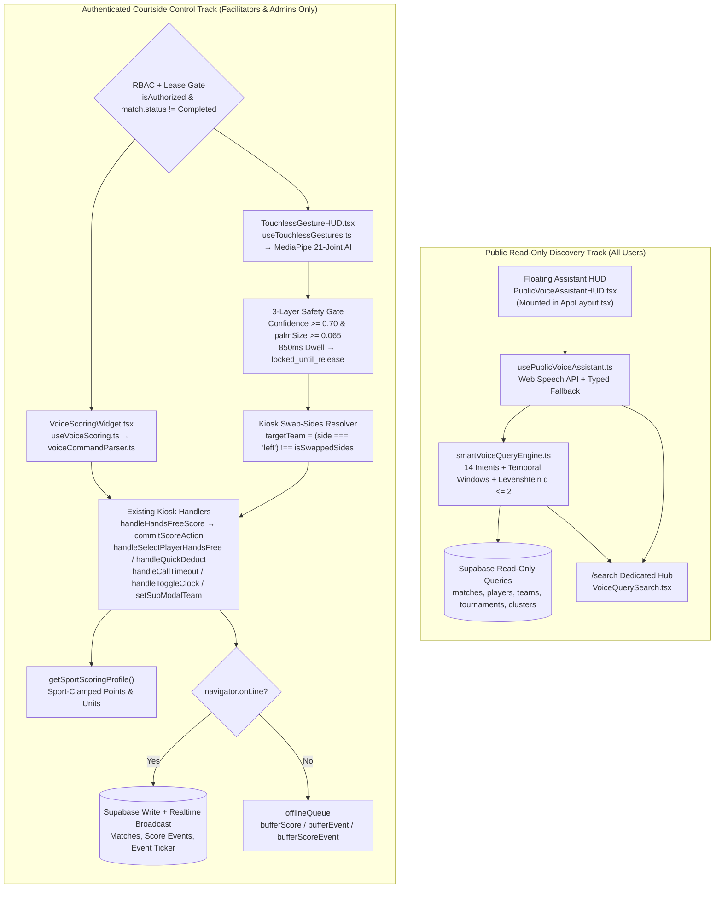

# PSU SportsTrack — HCI-2 Multimodal Interaction Implementation Guide

> **Course / Module:** Human-Computer Interaction 2 (HCI-2 Implementation Branch)  
> **Repository:** `sudo-marco-dev/PSU-SportsTrack`  
> **Branch:** `feat/multimodal-voice-scoring`  
> **Design Alignment:** Strictly complies with PSU SportsTrack's Nocturnal Slate + Palawan Solar Orange UI specification ([design_context.md](design_context.md)), PostgreSQL Row-Level Security (RLS), and Console Lease governance ([DEFENSE_MASTER_GUIDE.md](DEFENSE_MASTER_GUIDE.md)).

---

## Table of Contents

1. [Executive Overview & Problem Statement](#1-executive-overview--problem-statement)
2. [Seamless System Integration Architecture](#2-seamless-system-integration-architecture)
3. [Integration Proof Matrix (Core Citizen Design vs. Standalone Add-Ons)](#3-integration-proof-matrix-core-citizen-design-vs-standalone-add-ons)
4. [Feature Deep-Dive: Kiosk 21-Landmark Hand & Finger AI](#4-feature-deep-dive-kiosk-21-landmark-hand--finger-ai)
5. [Feature Deep-Dive: Courtside Voice Scoring Interface](#5-feature-deep-dive-courtside-voice-scoring-interface)
6. [Feature Deep-Dive: Public Conversational Voice & Query Search Portal](#6-feature-deep-dive-public-conversational-voice--query-search-portal)
7. [Scopes, Limitations & Engineering Trade-Offs](#7-scopes-limitations--engineering-trade-offs)
8. [Branch File Inventory & Symbol Traceability](#8-branch-file-inventory--symbol-traceability)
9. [Empirical Verification & Automated Test Coverage](#9-empirical-verification--automated-test-coverage)
10. [Anticipated HCI-2 Panel Defense Questions](#10-anticipated-hci-2-panel-defense-questions)
11. [Live Presentation Demo Script & Sample Triggers Reference](#11-live-presentation-demo-script--sample-triggers-reference)
12. [Detailed Guide: What Can vs. Cannot Be Done (Voice & Gesture Boundaries)](#12-detailed-guide-what-can-vs-cannot-be-done-voice--gesture-boundaries)

---

## 1. Executive Overview & Problem Statement

Standard sports management web apps rely exclusively on **WIMP / touch-only interaction** (tapping nested buttons, dropdowns, and modals). Under live university intramural conditions (Palawan State University multi-sport tournaments), touch-only interaction breaks down in two distinct user scenarios:

1. **Courtside Official Attention Split (Visual & Motor Bottleneck):**  
   During fast-paced possessions in basketball, volleyball, futsal, or sepak takraw, the table facilitator must watch the referee, check jersey numbers, track timeouts/substitutions, and log events simultaneously. Looking down at a tablet or laptop to tap `+2 Pts`, select a player, pause the game clock, or confirm substitutions introduces scoring lag and missed calls.
2. **Spectator & Athlete Navigation Friction (Information Discovery Bottleneck):**  
   Students, coaches, and fans arriving on the public portal often want direct answers to conversational questions (*"What's the last matches from basketball this last week?"*, *"Who won last year?"*, *"Top 3 highest scoring player"*, *"Top 5 highest win rate tribes or squads"*) rather than manually clicking across `/explorer`, `/ranking`, and `/athletics` filters.

This HCI-2 implementation branch solves both problems using **two deeply integrated multimodal subsystems**:
- **Authenticated Courtside Multimodal Deck (`FacilitatorKiosk` & `LiveMatch`)**: Combines **Web Speech Voice Commands** with a **MediaPipe 21-Landmark Optical Hand & Finger Pose Engine** so officials can operate scoring, player cycling, substitutions, timeouts, deductions, and clock pause/resume completely hands-free.
- **Public Natural-Language Voice & Omni-Search Portal (`AppLayout` + `/search`)**: Provides a floating assistant HUD (`PublicVoiceAssistantHUD`) backed by a temporal, fuzzy-matching, leaderboard-capable query engine (`smartVoiceQueryEngine` + `VoiceQuerySearch`) directly querying live Supabase tournament tables.

---

## 2. Seamless System Integration Architecture

Rather than mounting isolated UI toys, every multimodal input normalizes into PSU SportsTrack's **existing authoritative execution pipelines, database queries, lease controls, and visual tokens**.

---

## 3. Integration Proof Matrix (Core Citizen Design vs. Standalone Add-Ons)

To demonstrate that these features interact seamlessly with PSU SportsTrack rather than sitting bolted on top of it, every capability maps directly to existing domain invariants:

| Architectural Invariant | How Existing System Enforces It | How HCI-2 Multimodal Features Honor & Reuse It |
| :--- | :--- | :--- |
| **Single Authoritative Score Write Path** | `FacilitatorKiosk.tsx` commits points, player stats, undo history, audio chimes, and Realtime broadcasts via `commitScoreAction()`. | Both `voiceScoring` (`onScore`) and `touchlessGestures` (`onHandCommand`) call `handleHandsFreeScore()`, which resolves athlete focus and delegates directly to `commitScoreAction()`. Zero duplicated Supabase `update` or `insert` logic. |
| **Scorekeeper Console Lease & RLS** | Only users holding `claim_match_lease` (`isAuthorized` / `isAuthorizedScorekeeper`) can mutate scores; database RLS rejects unleased writes. | Multimodal decks only render inside `{isAuthorized && match.status !== 'Completed'}` in [FacilitatorKiosk.tsx](src/pages/FacilitatorKiosk.tsx#L2046) and `{isAuthorizedScorekeeper}` in [LiveMatch.tsx](src/pages/LiveMatch.tsx#L2325). Even simulator buttons cannot mutate Supabase without an active lease. |
| **Offline-First Courtside Buffering** | `commitScoreAction()` buffers into `offlineQueue.bufferScore`, `bufferEvent`, and `bufferScoreEvent` when `!navigator.onLine`. | Because voice and hand commands flow through `commitScoreAction()`, offline gymnasium scoring works identically for hands-free commands as for finger taps. |
| **9-Sport Rules Clamping** | `getSportScoringProfile(sport)` defines valid scoring increments per sport (e.g., `+1/+2/+3` for Basketball, `+1` for Volleyball/Soccer). | [FacilitatorKiosk.tsx](src/pages/FacilitatorKiosk.tsx#L1488-L1568) computes `touchlessMaxPoint` from `sportProfile.actions` so showing 3 fingers in Volleyball safely resolves to `+1 Point` rather than injecting invalid basketball points. |
| **Court Side Swap Synchronization** | `isSwappedSides` flips visual left/right team columns on court rotation. | Hand commands map dynamically via `(side === 'left') !== isSwappedSides ? 'a' : 'b'` in [FacilitatorKiosk.tsx](src/pages/FacilitatorKiosk.tsx#L1506), and `TouchlessGestureHUD` updates team labels automatically. |
| **Zero-404 Public Route Integrity** | React Router registers `/`, `/ranking`, `/explorer`, `/athletics`, `/search`, `/match/:id`, etc. | `publicVoiceAssistant.ts` and `smartVoiceQueryEngine.ts` only output verified route paths; ambiguous speech routes to `/search?q=...` (`VoiceQuerySearch.tsx`) instead of guessing nonexistent `/tournaments` or `/rankings` slugs. |
| **Anti-Slop Visual Governance** | [design_context.md](design_context.md) mandates Nocturnal Slate (`bg-slate-950`/`bg-slate-900`), Solar Orange `#F97316`, `tabular-nums`, `lucide-react` icons, and zero raw emojis. | All multimodal widgets use `lucide-react` icons, `bg-slate-950`, `orange-500`, `cyan-500`, and `tabular-nums`. Verified via automated regex scan returning `0` raw emojis across all multimodal files. |

---

## 4. Feature Deep-Dive: Kiosk 21-Landmark Hand & Finger AI

### Why Pixel-Difference ROI Was Replaced
Earlier motion-box heuristics divided the webcam into spatial rectangles. That caused false triggers whenever a head leaned sideways, lighting shifted, or a spectator walked behind the scorer's table.

The current implementation uses **Google MediaPipe `HandLandmarker`** (`@mediapipe/tasks-vision`, `runningMode: 'VIDEO'`, `numHands: 2`) executing **21-joint anatomical skeleton detection** directly in the browser via local WASM + `float16` model files (`public/mediapipe/wasm/` and `public/mediapipe/models/hand_landmarker.task`).

### Why It Ignores Faces, Walls & Background Noise
1. **Structural Skeleton Requirement:** Non-hand objects (faces, torsos, chairs, banners) do not produce valid 21-landmark hand predictions above `minDetectionConfidence` (`0.70`).
2. **Minimum Palm Scale Filter:** `classifyHandPose()` measures normalized wrist-to-middle-knuckle distance (`palmSize = dist2D(lm[0], lm[9])`) and rejects hands with `palmSize < 0.065` (`MIN_VALID_PALM_SIZE`), ignoring distant bystanders in the background.
3. **Sustained Dwell & Release-to-Rearm (`HandPoseDwellTracker`):**
   - **Layer 1 (Classification):** All 5 digits are checked independently using wrist-to-tip vs. wrist-to-PIP ratios and joint straightness dot products (`boneDot > 0`).
   - **Layer 2 (850ms Dwell Charge):** Switching finger counts mid-hold resets the `0%–100%` progress gauge.
   - **Layer 3 (`locked_until_release`):** After firing at `100%`, that hand enters a mandatory lock (`RELEASE TO REARM`) until the hand leaves frame or changes away from the triggered pose for `220ms`, making accidental rapid double-scoring impossible.
4. **Live Armed vs. Test Lock (Dry-Run):** Facilitators can toggle `Test Lock (Dry-Run)` in `TouchlessGestureHUD.tsx` to verify camera framing and live skeleton detection (`[DRY-RUN]` banner) without altering the live scoreboard.

### 8-Command Referee Finger Vocabulary
Team assignment uses **anatomical handedness** anywhere inside the camera frame (`Left Hand` controls the Left Column Team; `Right Hand` controls the Right Column Team), with a **Flip L/R** hardware button (`toggleInvertHandedness`) for external USB cameras that output pre-mirrored feeds:

| Hand Pose | Geometric Signature | Left Hand Effect | Right Hand Effect |
| :--- | :--- | :--- | :--- |
| `one_finger` | Index extended; others curled | `+1 Point` (Left Team) | `+1 Point` (Right Team) |
| `two_fingers` | Index + Middle extended | `+2 Points` (or sport max) | `+2 Points` (or sport max) |
| `three_fingers` | Index + Middle + Ring extended | `+3 Points` (or sport max) | `+3 Points` (or sport max) |
| `four_fingers` | All 4 fingers up, thumb tucked | Cycle Active Scorer (Left Team) | Cycle Active Scorer (Right Team) |
| `open_palm` | All 5 digits spread | Pause / Resume Match Clock | Pause / Resume Match Clock |
| `closed_fist` | All 4 fingers curled near palm center | Deduct `-1 Point` (Left Team) | Deduct `-1 Point` (Right Team) |
| `thumbs_up` | Thumb pointing upward above knuckle arch | Call Timeout (Left Team) | Call Timeout (Right Team) |
| `shaka` | Thumb + Pinky extended | Open Substitution Drawer (Left Team) | Open Substitution Drawer (Right Team) |

---

## 5. Feature Deep-Dive: Courtside Voice Scoring Interface

Implemented in [voiceCommandParser.ts](src/lib/voiceCommandParser.ts), [useVoiceScoring.ts](src/hooks/useVoiceScoring.ts), and [VoiceScoringWidget.tsx](src/components/match/VoiceScoringWidget.tsx), allowing table officials to issue spoken commands with Web Speech Synthesis (`speakConfirmation`) + audio confirmation chimes (`playScoreChime`, `playSubHornSound`, `playClockPauseSound`, `playClockStartSound`).

| Command Category | Example Spoken Utterances | Parsed Intent & Execution Hook |
| :--- | :--- | :--- |
| **Team & Player Scoring** | *"Give 2 points to Team A"*, *"Give 2 points to Team A player 1"*, *"Three pointer Team B"* | `score` → `onScore` → `handleHandsFreeScore` → `commitScoreAction` |
| **Player Focus Selection** | *"Pick player 5 Team A"*, *"Select player 12 CBA"* | `select_player` → `onSelectPlayer` → `handleSelectPlayerHandsFree` |
| **Substitutions** | *"Substitute player 1 to player 2 from Team A"*, *"Sub in 10 for 4 Team B"* | `substitution` → `onSubstitution` → `handleConfirmSub` |
| **Game & Clock Control** | *"Pause clock"*, *"Pause game"*, *"Resume match"*, *"Unpause"* | `clock` → `onClockControl` → `handleToggleClock` |
| **Point Deductions** | *"Deduct 2 points from Team B"*, *"Minus 1 Team A"* | `deduct` → `onDeduct` → `handleQuickDeduct` |
| **Fouls & Timeouts** | *"Foul on player 7 Team A"*, *"Timeout Team B"* | `foul` / `timeout` → `handleAddFoul` / `handleCallTimeout` |
| **Undo & Commentary** | *"Undo last score"*, *"Commentary fast break layup by Santos"* | `undo` / `commentary` → `handleUndoLastScore` / event ticker log |

> **Manual Fallback Parity:** Every courtside action can also be triggered via the quick-command chips or typed command box inside `VoiceScoringWidget.tsx` when running on unsupported browsers or muted environments.

---

## 6. Feature Deep-Dive: Public Conversational Voice & Query Search Portal

Implemented in [smartVoiceQueryEngine.ts](src/lib/smartVoiceQueryEngine.ts), [publicVoiceAssistant.ts](src/lib/publicVoiceAssistant.ts), [PublicVoiceAssistantHUD.tsx](src/components/common/PublicVoiceAssistantHUD.tsx), and [VoiceQuerySearch.tsx](src/pages/VoiceQuerySearch.tsx).

### Key Capabilities
- **14 Context-Aware Intents (`QueryIntent`):** Separates analytical questions (`question_winner`, `question_top_college`, `question_highest_mvp`, `question_highest_win_rate`, `question_top_scorers`, `question_tribe_squad_win_rate`) from filtered directory searches (`filter_matches`, `filter_players`, `filter_colleges`, `filter_schedules`, `filter_stars`) and verified route navigation (`navigation`).
- **Temporal Window Extraction (`TemporalWindow`):** Understands relative natural phrases including `today` (*"for this day"*), `yesterday`, `this_week`, `last_week` (*"this last week"*), `next_week`, `this_month`, `last_month`, `next_month`, `this_year`, and `last_year`, plus smart fallback notices when an empty time window broadens to available historical or upcoming fixtures.
- **Vague Top-N Leaderboards:** Answers queries like *"What's the top 3 highest scoring player?"* (aggregating real per-player scoring totals via `fetchBatchPlayerSummaries`) and *"What's the top 5 highest win rate tribes or squads?"* (calculating win percentages across PSU `clusters` and `teams`) with ranked rows directly inside the Direct Answer card.
- **Fuzzy Typo & Acoustic Mispelling Recovery:** Uses `levenshteinDistance` (`maxDistance = 2`) plus PSU college acronym aliases (`"cet"`, `"ceat"`, `"see ba"` → `CBA`, `"kass"` → `CAS`) to recover from Web Speech transcription errors and display an Auto-Correction notice.

---

## 7. Scopes, Limitations & Engineering Trade-Offs

For transparent academic reporting in HCI-2, the following technical boundaries apply to the current branch:

### A. Browser Speech Recognition Dependencies (`useVoiceScoring`, `usePublicVoiceAssistant`)
1. **Browser Engine Support:** Relies on Web Speech API (`SpeechRecognition` / `webkitSpeechRecognition`). Works natively in Chromium-based browsers (Chrome, Edge) and Safari, but lacks full out-of-the-box support in Firefox Desktop (where UI automatically surfaces typed command input and quick-chip fallbacks).
2. **Online Transcription Requirement:** Standard Chromium Web Speech streams audio to browser vendor speech servers. In completely offline gyms, facilitators remain protected because both `VoiceScoringWidget` manual command input and **MediaPipe 21-Landmark Hand Tracking** (using local WASM/model files) operate offline.
3. **Acoustic Interference & Overlapping Speech:** Live whistle blasts, PA announcers, or crowd cheers near an omnidirectional laptop mic can inject speech recognition errors. `voiceCommandParser.ts` minimizes damage by rejecting incomplete commands lacking team/point resolution rather than guessing.
4. **Language Scope:** Configured for English (`en-US`) sports terminology and PSU college names/acronyms; mixed Tagalog/English (`Taglish`) vernacular beyond standard team names/numbers is outside current parser rules.

### B. Optical 21-Landmark Hand Tracking Boundaries (`touchlessGestureEngine`, `handPoseClassifier`)
1. **Camera Lighting & Motion Blur:** Webcam optical hand landmarks degrade in severe backlighting, dark gyms, or rapid mid-motion swinging. The `850ms` stationary dwell requirement mitigates transient blur misfires.
2. **Distance & Palm Scale Bounds:** Hands too far from the camera (`palmSize < 0.065`) or clipped past the camera edges are intentionally discarded by Layer 1 filtering. Optimal framing is `0.4m – 1.8m` from the lens.
3. **Single-Operator Assumption & Hardware Mirroring:** `HandLandmarker` tracks `numHands: 2`. If a second person holds a hand closely in front of the camera next to the table official, their hand could also be tracked; `Test Lock (Dry-Run)` and `Live Armed` controls mitigate table hand-offs. Additionally, external USB cameras without native horizontal flipping can invert anatomical `Left`/`Right` labels, addressed via the **Flip L/R** toggle (`invertHandedness`).

### C. Deterministic Rule-Based NLU Bounds (`smartVoiceQueryEngine`, `voiceCommandParser`)
1. **No Generative LLM or Multi-Turn Memory:** Queries are processed deterministically on a single utterance (`parseNaturalVoiceQuery`) without an external cloud LLM API or cross-turn conversation memory (*"Now filter those by CET"* requires restating the full request). This trade-off guarantees zero API token costs, deterministic privacy, and sub-50ms parse latency.
2. **Edit-Distance Bounds:** Fuzzy spell recovery stops at Levenshtein distance `<= 2` to prevent silent false matches on unrelated words.
3. **Read-Only Public Boundary:** Public voice search cannot mutate records, claim leases, or expose admin/verification-only tables (`verification` documents, audit logs, or email fields stay locked behind PostgreSQL RLS).

---

## 8. Branch File Inventory & Symbol Traceability

| Layer | File Path | Core Exports / Symbols | Responsibility |
| :--- | :--- | :--- | :--- |
| **Types** | [src/types/multimodal.ts](src/types/multimodal.ts) | `HandSide`, `HandPoseName`, `TrackedHandState`, `GestureState`, `ParsedVoiceCommand` | Shared type contracts across hand AI, voice scoring, and UI widgets |
| **Hand Classifier** | [src/lib/handPoseClassifier.ts](src/lib/handPoseClassifier.ts) | `classifyHandPose`, `HandPoseDwellTracker`, `resolveMirroredHandSide`, `describeHandAction` | Zero-DOM 21-landmark geometry & 3-layer dwell/release lock |
| **Optical Engine** | [src/lib/touchlessGestureEngine.ts](src/lib/touchlessGestureEngine.ts) | `TouchlessGestureEngine`, `createIdleTrackedHandState` | MediaPipe `HandLandmarker` runtime, 30fps loop & wireframe canvas |
| **Local AI Assets** | [public/mediapipe/](public/mediapipe/) | `wasm/*`, `models/hand_landmarker.task` | Offline-capable WASM runtime and float16 hand landmark weights |
| **Touchless Hook** | [src/hooks/useTouchlessGestures.ts](src/hooks/useTouchlessGestures.ts) | `useTouchlessGestures` | Webcam lifecycle, `isArmed` lock, `invertHandedness`, `simulateHandCommand` |
| **Kiosk Hand HUD** | [src/components/kiosk/TouchlessGestureHUD.tsx](src/components/kiosk/TouchlessGestureHUD.tsx) | `TouchlessGestureHUD` | Mirrored video + skeleton canvas, dual hand cards, pose simulator & guide |
| **Voice Parser** | [src/lib/voiceCommandParser.ts](src/lib/voiceCommandParser.ts) | `parseVoiceCommand`, `resolveTeam` | Courtside command grammar for scoring, focus, subs, clock, deduct, foul |
| **Voice Hook & UI** | [src/hooks/useVoiceScoring.ts](src/hooks/useVoiceScoring.ts), [src/components/match/VoiceScoringWidget.tsx](src/components/match/VoiceScoringWidget.tsx) | `useVoiceScoring`, `VoiceScoringWidget`, `speakConfirmation` | Web Speech Recognition, TTS confirmation, Web Audio chimes & manual fallback |
| **Public NLU Engine** | [src/lib/smartVoiceQueryEngine.ts](src/lib/smartVoiceQueryEngine.ts), [src/lib/publicVoiceAssistant.ts](src/lib/publicVoiceAssistant.ts) | `parseNaturalVoiceQuery`, `executeSmartVoiceQuery`, `levenshteinDistance`, `parsePublicVoiceQuery` | Sentence intent NLU, temporal windows, Top-N leaderboards & fuzzy correction |
| **Public UI & Hub** | [src/hooks/usePublicVoiceAssistant.ts](src/hooks/usePublicVoiceAssistant.ts), [src/components/common/PublicVoiceAssistantHUD.tsx](src/components/common/PublicVoiceAssistantHUD.tsx), [src/pages/VoiceQuerySearch.tsx](src/pages/VoiceQuerySearch.tsx) | `PublicVoiceAssistantHUD`, `VoiceQuerySearch` | Floating universal mic launcher (`AppLayout`) and `/search` omni-query hub |
| **App Integration** | [src/pages/FacilitatorKiosk.tsx](src/pages/FacilitatorKiosk.tsx), [src/pages/LiveMatch.tsx](src/pages/LiveMatch.tsx), [src/components/AppLayout.tsx](src/components/AppLayout.tsx), [src/App.tsx](src/App.tsx) | `handleHandsFreeScore`, `commitScoreAction` | Connects hands-free commands directly to leases, sport rules, and offline sync |

---

## 9. Empirical Verification & Automated Test Coverage

Verified on branch `feat/multimodal-voice-scoring`:

1. **Production Build (`npm run build` / `tsc -b && vite build`):**  
   Exited with **code `0`** (`2468` modules transformed cleanly).
2. **Zero-Emoji & Anti-Slop Static Check:**  
   Regex scan for raw Unicode surrogate emojis and literal TeX arrows returned **`0` matches** across `TouchlessGestureHUD.tsx`, `FacilitatorKiosk.tsx`, `touchlessGestureEngine.ts`, `handPoseClassifier.ts`, and `useTouchlessGestures.ts`.
3. **Playwright Automated Test Suite (`64 / 64` Passed in `24.4s`):**
   - [tests/touchless-gestures.spec.ts](tests/touchless-gestures.spec.ts) (`7 passed`): Validates all 8 synthetic 21-landmark poses, small-palm (`palmSize < 0.065`) & ambiguous pose rejection, `resolveMirroredHandSide` & `Invert L/R`, `HandPoseDwellTracker` 850ms hold + `locked_until_release` double-fire prevention, sport-clamped descriptions, zero-emoji compliance, and HTTP `200` delivery of local `/mediapipe/models/hand_landmarker.task` and `/mediapipe/wasm/vision_wasm_internal.js`.
   - [tests/multimodal-voice-scoring.spec.ts](tests/multimodal-voice-scoring.spec.ts) (`14 passed`): Covers scoring, jersey attribution, substitutions, game pause/resume without `"clock"`, deductions, fouls, timeouts, undo, player selection, and commentary.
   - [tests/smart-conversational-voice-search.spec.ts](tests/smart-conversational-voice-search.spec.ts) (`13 passed`): Covers Top-3 scorers, Top-5 tribes/squads win rate, temporal filters, fuzzy auto-correction, and Direct Answer cards.
   - [tests/public-voice-assistant.spec.ts](tests/public-voice-assistant.spec.ts) (`15 passed`) and [tests/voice-query-search.spec.ts](tests/voice-query-search.spec.ts) (`15 passed`): Verify floating HUD mounting, database query execution on `/search`, zero-404 navigation, and empty/reset states.

---

## 10. Anticipated HCI-2 Panel Defense Questions

1. **"How do we know the touchless feature is genuinely detecting a real hand instead of random motion?"**  
   Because `TouchlessGestureEngine` runs MediaPipe `HandLandmarker`, which outputs 21 3D hand-joint coordinates only when anatomical hand geometry is present, then validates normalized `palmSize >= 0.065`, classifies individual finger extension dot products across 8 distinct poses, requires an `850ms` steady hold, and locks until hand release (`locked_until_release`).
2. **"If someone uses voice or hand scoring, can they bypass the official scorekeeper lock or assign points illegally for a different sport?"**  
   No. Both UI controls are hidden unless `isAuthorized` (active scorekeeper lease + allowed role) is `true` and `match.status !== 'Completed'`. Writes execute solely through `handleHandsFreeScore` → `commitScoreAction`, inheriting Supabase RLS, offline buffering, and `getSportScoringProfile` point clamping.
3. **"Does this break if a browser doesn't support the Web Speech API or the gym has weak Wi-Fi?"**  
   No. MediaPipe WASM and `hand_landmarker.task` are self-hosted in `public/mediapipe/` for offline execution, `commitScoreAction` automatically routes writes into `offlineQueue` when offline, and every voice widget provides typed input chips plus pose simulator buttons as clean graceful fallbacks.
4. **"Why use deterministic rule/NLU parsing for public voice search instead of sending queries to an external LLM?"**  
   Deterministic NLU (`parseNaturalVoiceQuery`) executes locally in milliseconds with zero API keys, zero external cost per student search, predictable Levenshtein typo recovery (`distance <= 2`), strict zero-404 route whitelisting, and verifiable query execution directly against PSU's live PostgreSQL schema.

---

## 11. Live Presentation Demo Script & Sample Triggers Reference

Use the following **tested demo lines and gestures** during your HCI-2 presentation. Every utterance below is mapped directly to its exact parser intent in [smartVoiceQueryEngine.ts](src/lib/smartVoiceQueryEngine.ts), [publicVoiceAssistant.ts](src/lib/publicVoiceAssistant.ts), [voiceCommandParser.ts](src/lib/voiceCommandParser.ts), and [handPoseClassifier.ts](src/lib/handPoseClassifier.ts).

### 11.1 Part 1 — Public Conversational Voice Search Demo Lines (`PublicVoiceAssistantHUD` & `/search`)

> **How to Launch in Presentation:** Click the bottom-right floating microphone button (`btn-universal-voice-assistant`) on any public page, or open `/search` directly. You can either speak into the microphone or type/click the exact phrase inside the search bar.

#### A. Vague Top-N Leaderboards & Analytical Questions (Best Opening Demo Lines)
| Exact Demo Line to Speak / Type | Parsed Intent (`QueryIntent`) | Target Route / View | Expected System & UI Behavior |
| :--- | :--- | :--- | :--- |
| **"What's the top 3 highest scoring player?"** | `question_top_scorers` (`topN = 3`) | `/athletics?sort=points` (or `/search`) | Aggregates `fetchBatchPlayerSummaries()`, speaks the #1 scorer's total points & PPG, and renders a 3-row ranked Direct Answer card. |
| **"What's the top 5 highest win rate tribes or squads?"** | `question_tribe_squad_win_rate` (`topN = 5`, `entityTarget = 'both'`) | `/ranking?tab=win_rate` (or `/search`) | Computes win rates across all completed matches for both PSU `clusters` (Tribes) and `teams` (Squads) and renders a Top-5 ranked leaderboard card. |
| **"Who is the highest rated college right now?"** | `question_top_college` | `/ranking` | Evaluates live university standings across completed fixtures and highlights the #1 leading college in a Direct Answer card. |
| **"Search for highest MVP"** *(or **"Who has the most gold stars?"**)* | `question_highest_mvp` | `/ranking?tab=stars` | Ranks athletes by weighted star score (`Gold * 3 + Red * 1`) and displays the top MVP leader card. |
| **"Search for player with highest win rate"** | `question_highest_win_rate` (`topN = 1`) | `/athletics?sort=win_rate` | Computes athlete match participation win percentages and surfaces the highest win-rate athlete. |
| **"Who won last week?"** | `question_winner` (`last_week`) | `/search?q=...&type=matches` | Queries completed matches in the previous week window and announces the winning team and final score. |
| **"Who won last year?"** | `question_winner` (`last_year`) | `/search?q=...&type=matches` | Checks previous calendar year (`match_time \|\| created_at`); if no fixtures exist for that year, triggers Smart Temporal Fallback to the latest completed match. |

#### B. Conversational Temporal & Sport-Filtered Fixture Searches
| Exact Demo Line to Speak / Type | Resolved `TemporalWindow` & `sport` | Expected System & UI Behavior |
| :--- | :--- | :--- |
| **"What's the last matches from basketball this last week?"** | `type: 'last_week'`, `expectedStatus: 'Completed'`, `sport: 'basketball'` | Filters completed Basketball fixtures from last week (or shows a clear fallback badge if the window is empty). |
| **"What's the upcoming games for this month?"** | `type: 'this_month'`, `expectedStatus: 'Scheduled'` | Displays all scheduled fixtures within the current calendar month with active context badges. |
| **"What's the upcoming games for this day?"** *(or **"games today"**)* | `type: 'today'`, `expectedStatus: 'Scheduled'` | Filters today's scheduled matches (`00:00:00` to `23:59:59` local time). |
| **"What's the upcoming games for this week?"** | `type: 'this_week'`, `expectedStatus: 'Scheduled'` | Lists all scheduled fixtures for the current week. |
| **"Search for volleyball games next week"** | `type: 'next_week'`, `expectedStatus: 'Scheduled'`, `sport: 'volleyball'` | Filters next week's scheduled Volleyball fixtures. |
| **"Search past games last month"** | `type: 'last_month'`, `expectedStatus: 'Completed'` | Lists completed matches from the previous calendar month. |

#### C. Directory & Entity Lookups (Athletes, Colleges, Sport Schedules)
| Exact Demo Line to Speak / Type | Parsed Query Type | Expected System & UI Behavior |
| :--- | :--- | :--- |
| **"Search for player Dela Cruz"** *(or **"Player Santos"**)* | `filter_players` (`player_search`) | Queries `users` table by `full_name` and displays matching verified athlete cards with college affiliation. |
| **"Search for CET"** *(or **"College of Engineering"** or **"Colleges"**)* | `filter_colleges` (`college_search`) | Resolves `CET` (`College of Engineering and Technology`) or lists all 9 PSU colleges with direct `View Standings` links. |
| **"Basketball schedule"** *(or **"Show pickleball schedule"**)* | `filter_matches` / `sport_schedule` | Displays scheduled matches and tournament brackets for that sport (`basketball`, `volleyball`, `football`, `sepak takraw`, `badminton`, `table tennis`, `chess`, `soccer`, `futsal`, `baseball`, `softball`, `pickleball`). |

#### D. Direct Zero-404 Navigation Shortcuts
| Exact Demo Line to Speak / Type | Verified Route Target | Spoken Confirmation |
| :--- | :--- | :--- |
| **"Go to rankings"** *(or **"Open standings"**)* | `/ranking` | *"Navigating to College Standings and Medal Rankings."* |
| **"Open tournaments"** *(or **"Go to brackets"**)* | `/explorer` | *"Navigating to Tournament Explorer."* |
| **"Navigate to athletics"** *(or **"Open scouting"**)* | `/athletics` | *"Navigating to Athletics Scouting Hub."* |
| **"Take me to search"** | `/search` | *"Opening Dedicated Voice Query Search Hub."* |
| **"Go to home"** | `/` | *"Navigating to PSU SportsTrack Home."* |

#### E. Resilience & Auto-Correction Demo Lines (Showcasing Edge-Case Intelligence)
| Exact Demo Line to Speak / Type | What It Demonstrates to the Panel | Exact Engine Behavior |
| :--- | :--- | :--- |
| **"Search for baskitball games this week"** | **Levenshtein Fuzzy Sport Recovery (`distance <= 2`)** | Auto-corrects `"baskitball"` → `"basketball"` and renders an amber **Auto-Correction Notice** pill on `/search`. |
| **"Show see ba standings"** *(or **"kass colleges"**)* | **Phonetic College Alias Recovery** | Maps speech-to-text homophones `"see ba"` → `CBA` and `"kass"` → `CAS` automatically. |
| **"Who won in baseball last year?"** | **Smart Temporal Window Fallback** | When a strict time/sport combination returns `0` matches, automatically broadens to available completed records and displays a transparent fallback explanation banner instead of a blank screen. |

---

### 11.2 Part 2 — Courtside Voice Scoring Demo Lines (`FacilitatorKiosk` & `LiveMatch`)

> **Prerequisite for Live Demo:** Log in as a `facilitator` or `super_admin`, open an `Ongoing` match in Kiosk mode (`/match/:id/kiosk`), and ensure you hold the **Console Lease**. Expand the **Hands-Free Multimodal Deck** and click **Start Voice** (or type/click inside `VoiceScoringWidget`).

| Official Action | Exact Demo Line to Speak | Parsed Output (`ParsedVoiceCommand`) | Kiosk Execution Result |
| :--- | :--- | :--- | :--- |
| **Team Field Goal (`+2`)** | **"Give 2 points to Team A"** *(or use actual team name, e.g., **"Add 2 points to CET"**)* | `intent: 'score', team: 'a', points: 2, actionType: 'Field Goal'` | Commits `+2` to Team A via `commitScoreAction`, plays score chime, and speaks confirmation. |
| **Player-Attributed Score** | **"Give 2 points to Team A player 1"** *(or **"3 points to Team B number 12"**)* | `intent: 'score', team: 'a', points: 2, playerNumber: 1` | Focuses jersey `#1` on Team A, records `+2` points and `PTS_2` player stat event, and logs `#1` in the live match ticker. |
| **3-Pointer Shortcut (`+3`)** | **"Three pointer for Team B"** *(or **"Give 3 points to Team B"**)* | `intent: 'score', team: 'b', points: 3, actionType: '3-Pointer'` | Awards `+3` (or clamps to sport max in 1-point sports). |
| **Free Throw / Single (`+1`)** | **"Free throw for Team A"** *(or **"Add 1 point to Team A"**)* | `intent: 'score', team: 'a', points: 1, actionType: 'Free Throw'` | Awards `+1` to Team A. |
| **Hands-Free Player Focus** | **"Pick player 5 Team A"** *(or **"Select player 8 Team B"**)* | `intent: 'select_player', team: 'a', playerNumber: 5` | Sets active scorer focus to jersey `#5` (`selectedScorerA`) without adding points yet. |
| **2-Player Substitution** | **"Substitute player 1 to player 2 from Team A"** *(or **"Sub in 10 for 4 Team B"**)* | `intent: 'substitution', subOutPlayerNumber: 1, subInPlayerNumber: 2` | Executes roster swap (`handleConfirmSub`), plays sub horn, and logs `[SUBSTITUTION]` to match events. |
| **Pause Game / Clock** | **"Pause game"** *(or **"Pause clock"**, **"Stop time"**, **"Freeze match"**)* | `intent: 'clock', clockAction: 'pause'` | Pauses the running Kiosk game clock and plays clock-pause audio cue. |
| **Resume Game / Clock** | **"Resume match"** *(or **"Resume clock"**, **"Unpause"**, **"Start time"**)* | `intent: 'clock', clockAction: 'resume'` | Resumes the paused Kiosk game clock. |
| **Score Deduction** | **"Deduct 2 points from Team B"** *(or **"Minus 1 point Team A"**)* | `intent: 'deduct', team: 'b', points: 2` | Calls `handleQuickDeduct('b', 2)` to log a compensating score correction. |
| **Player or Team Foul** | **"Foul on player 7 Team A"** *(or **"Foul on Team B"**)* | `intent: 'foul', team: 'a', playerNumber: 7` | Increments team/player foul counter (`handleAddFoul`). |
| **Official Timeout** | **"Timeout Team A"** *(or **"Call time for Team B"**)* | `intent: 'timeout', team: 'a'` | Triggers official timeout (`handleCallTimeout`), deducts timeout pip, and sounds klaxon. |
| **Undo Last Score** | **"Undo last score"** *(or **"Cancel last"**)* | `intent: 'undo'` | Reverts the most recent score action (`handleUndoLastScore`). |
| **Live Commentary** | **"Commentary fast break layup by number 12"** | `intent: 'commentary', notes: 'fast break layup by number 12'` | Publishes live text commentary to the spectator ticker. |

---

### 11.3 Part 3 — Kiosk 21-Landmark Hand & Finger Gesture Demo Script (`TouchlessGestureHUD`)

Run this 5-step sequence during your defense to prove the camera tracks **real anatomical hand/finger landmarks** rather than random screen regions:

1. **Step 1 — Enable Camera & Show Face Immunity (`Test Lock / Dry-Run`):**
   - Click **Enable Hand AI Camera** (`btn-toggle-touchless-camera`), then click **Live Armed** to switch into **Test Lock (Dry-Run)** (`btn-toggle-touchless-armed`).
   - Lean your face left, right, and center across the camera frame with no hands raised.
   - **Point out to the panel:** Both `Left Hand` and `Right Hand` cards stay at `IDLE (0%)` because faces lack a 21-joint hand skeleton (`palmSize >= 0.065`, confidence `>= 0.70`).
2. **Step 2 — Show Anatomical Left vs. Right Hand Anywhere in Frame:**
   - Raise your **Left Hand** on the *right* side of the webcam frame and hold **2 Fingers** (`Index + Middle`).
   - **Point out to the panel:** The orange **Left Hand** card charges to `100%` and displays `[DRY-RUN] LEFT HAND: +2 Points`, proving handedness is anatomical rather than tied to a left/right screen box.
3. **Step 3 — Switch to `Live Armed` & Demonstrate Referee Finger Poses (`850ms` Dwell):**
   - Click **Test Lock (Dry-Run)** to return to **Live Armed**.
   - Hold **Left Hand — 4 Fingers** (thumb tucked) for `850ms` → cycles the focused athlete on the Left Team.
   - Hold **Left Hand — 2 Fingers** for `850ms` → awards `+2 Points` to the focused Left Team athlete.
   - Hold **Right Hand — 3 Fingers** (`Index + Middle + Ring`) for `850ms` → awards `+3 Points` to the Right Team.
4. **Step 4 — Demonstrate the `RELEASE TO REARM` Anti-Double-Score Lock:**
   - Keep holding **Right Hand — 3 Fingers** continuously in front of the camera after it fires.
   - **Point out to the panel:** The badge locks at `RELEASE TO REARM (0%)` and **never double-scores** no matter how long the hand stays up. Lower your hand for `220ms` to watch it rearm back to `IDLE`.
5. **Step 5 — Demonstrate Game Control Poses (`Open Palm`, `Closed Fist`, `Thumbs Up`, `Shaka`):**
   - Hold **Open Palm (5 Fingers)** → Pauses or resumes the match clock.
   - Hold **Closed Fist (0 Fingers curled)** → Deducts `-1 Point` correction on that hand's team.
   - Hold **Thumbs Up** → Calls an official Timeout for that hand's team.
   - Hold **Shaka (Thumb + Pinky)** → Opens the Substitution Drawer for that hand's team.

---

## 12. Detailed Guide: What Can vs. Cannot Be Done (Voice & Gesture Boundaries)

### 12.1 Public Voice Search (`smartVoiceQueryEngine.ts` & `publicVoiceAssistant.ts`) — Can vs. Cannot Matrix

| Capability Dimension | What You **CAN** Say (Supported) | What You **CANNOT** Say (Unsupported) | Exact Parser / System Behavior When Attempted | Valid Alternative Phrasing |
| :--- | :--- | :--- | :--- | :--- |
| **1. Conversational Memory (Single-Turn vs. Multi-Turn)** | Complete self-contained questions in one sentence: *"What's the last matches from basketball this last week?"* | Contextual follow-up pronouns relying on a previous turn: *"What about volleyball?"* or *"Now filter those by CET."* | Each query runs statelessly through `parseNaturalVoiceQuery()`. Follow-up fragments are treated as standalone searches (e.g., searching all volleyball matches without the prior time filter). | Restate the full intent in one sentence: *"What's the last matches from volleyball this last week?"* |
| **2. Temporal Filtering (`TemporalWindow`)** | Relative natural time windows: `today` / `this day` / `tonight`, `yesterday`, `this week`, `last week` / `this last week`, `next week`, `this month`, `last month`, `this year`, `last year`, `upcoming`, `past` / `recent`. | Arbitrary calendar dates, clock times, or custom date ranges: *"Games on October 14 at 3 PM"* or *"Matches between March 2 and March 9."* | `resolveTemporalWindow()` returns `undefined` for specific calendar dates and searches across all dates for the mentioned sport/college. | Use relative windows: *"Upcoming basketball games this month"* or filter manually on `/explorer`. |
| **3. Statistical Aggregations & Leaderboards** | Top-N scorers (`top 3 highest scoring player`), Top-N tribe/squad win rates (`top 5 highest win rate tribes or squads`), athlete win rate, MVP/star leaders, and college standings. | Granular box-score sub-statistics not stored as separate DB columns: *"Who has the most rebounds, assists, or steals in the 3rd quarter?"* or *"Free throw percentage leader."* | Falls back to `filter_players` or `general` search on `/search` because the database schema tracks match scores, `PTS_x` events, win/loss records, and Gold/Red stars. | Ask for supported metrics: *"What's the top 3 highest scoring player?"* or *"Search for highest MVP."* |
| **4. Fuzzy Typo & Homophone Recovery** | 1-to-2 character typos on sports (`"baskitball"`, `"vollyball"`, `Levenshtein <= 2`), 1-char typos on college codes (`<= 1`), and registered phonetic aliases (`"see ba"`, `"kass"`, `"ceat"`). | Severe phonetic distortion (`> 2` edits, e.g., *"bzkxball"*), non-PSU colleges, or conversational Tagalog sentences (*"Sino ang nanalo kahapon sa basketball?"*). | Unrecognized words are not force-matched to random sports/colleges; the engine routes to `/search?q=...` and shows a clean Empty State with a `Reset` button if no DB rows match. | Speak English keywords with PSU college codes/names (*"Who won yesterday in basketball?"*). |
| **5. Compound Multi-Intent Sentences** | Combining **Sport + College + Temporal Window** in one query: *"Upcoming basketball games for CET this week."* | Combining **multiple distinct questions/actions** in one breath: *"Who won last week and who is the top scorer and open rankings?"* | Deterministic priority cascade executes the first matched high-priority intent (`question_top_scorers` precedes `question_winner`, which precedes `navigation`). | Ask one question or navigation command per voice trigger. |
| **6. Public Read-Only Security Boundary** | Searching any public tournament, match fixture, athlete profile, college standing, or schedule. | Attempting to mutate scores or access admin routes from the public assistant: *"Add 3 points to CET"* or *"Open admin audit logs."* | `PublicVoiceAssistantHUD` has zero write hooks and only whitelists public routes (`/`, `/ranking`, `/explorer`, `/athletics`, `/search`). Admin/write phrases harmlessly route to `/search?q=...`. | Use the authenticated Courtside Kiosk (`/match/:id/kiosk`) with a valid scorekeeper lease for scoring. |

---

### 12.2 Courtside Voice Scoring (`voiceCommandParser.ts` & `useVoiceScoring.ts`) — Can vs. Cannot Matrix

| Capability Dimension | What You **CAN** Do (Supported) | What You **CANNOT** Do (Unsupported) | Exact Parser / System Behavior When Attempted | Valid Alternative Phrasing |
| :--- | :--- | :--- | :--- | :--- |
| **1. Team Target Resolution (`resolveTeam`)** | Specify `"Team A"`, `"Team B"`, `"Team 1"`, `"Team 2"`, or the actual competing team/college name or word (`"Give 2 points to CET"`). | Omit the team when awarding points: *"Give 2 points"* or *"Three pointer!"* without naming a team. | `useVoiceScoring` blocks execution and speaks feedback: *"Could not detect which team. Please specify Team A or Team B."* | Always include the team: *"Give 2 points to Team A"* or *"Three pointer Team B."* |
| **2. Point Increments (`extractPoints`)** | Spoken action terms (`"free throw"` = 1, `"goal"` = 1, `"layup"`/`"dunk"`/`"basket"`/`"field goal"` = 2, `"three pointer"`/`"triple"` = 3), digits `1–10`, or number words `"one"` through `"five"`. | Request large arbitrary point jumps (`"Add 50 points to Team A"`) or arithmetic expressions (`"Set Team A score to 42"`). | Digits `> 10` and number words `> five` are ignored by `extractPoints()`, returning `intent: 'unknown'` so a misheard number never corrupts the match score. | Issue standard per-play increments (`+1`, `+2`, `+3`) or use Kiosk manual controls. |
| **3. Player Attribution (`extractPlayerNumber`)** | Target players by jersey number (`0–99` digits or spoken words `"zero"` through `"twenty five"`): *"Give 2 points to Team A player 12"* or *"Pick player 5 Team A."* | Attribute points by speaking an athlete's full name/surname: *"Give 2 points to Dela Cruz from Team A."* | `extractPlayerNumber()` looks for `#` / `player` / `number` / `jersey` + number. If no jersey number is spoken, the score is credited to the currently focused player (`selectedScorerA/B`) or team total. | Speak the athlete's jersey number: *"Give 2 points to Team A player 12."* |
| **4. Roster Substitutions (`parseSubstitution`)** | Two-number swap syntax: *"Substitute player 1 to player 2 from Team A"*, *"Sub out 4 for 10 Team B"*, or *"Sub in 10 for 4 Team B."* | Whole-lineup swaps (*"Sub out all starters"*) or single-number commands (*"Substitute player 5"*). | `parseSubstitution()` requires extracting two valid jersey numbers (`subOut` and `subIn`). Single-number phrases do not fire a substitution. | State both outgoing and incoming jersey numbers: *"Sub in 10 for 4 Team A."* |
| **5. Game Clock Control (`clock` intent)** | Binary state transitions: *"Pause clock"*, *"Pause game"*, *"Stop time"*, *"Freeze match"*, *"Resume match"*, *"Unpause"*, *"Start time"*. | Arbitrary clock editing or period jumping by voice: *"Set clock to 2 minutes 15 seconds"* or *"Jump to 4th quarter."* | Only `clockAction: 'pause' \| 'resume'` is dispatched to `handleToggleClock()`. If the clock is already paused, saying *"Pause game"* is a safe no-op. | Use the Kiosk center console period/clock adjustment controls for custom time edits. |
| **6. Score Deductions & Undo (`deduct` / `undo`)** | Exact point deductions (*"Deduct 2 points from Team B"*, *"Minus 1 Team A"*) or reverting the last score (*"Undo last score"*). | Multi-step historical rollback by voice (*"Undo the last 5 plays"* or *"Delete the 1st quarter score"*). | `handleUndoLastScore()` holds a single-action reference (`lastScoreActionRef`) and resets `canUndo` after reverting once. | Use `"Deduct X points from Team A/B"` for additional score corrections. |

---

### 12.3 Kiosk 21-Landmark Hand & Finger Control (`handPoseClassifier.ts` & `TouchlessGestureEngine`) — Can vs. Cannot Matrix

| Capability Dimension | What You **CAN** Do (Supported) | What You **CANNOT** Do (Unsupported) | Exact Engine Behavior When Attempted | Best Practice for Live Demo |
| :--- | :--- | :--- | :--- | :--- |
| **1. Static Finger Geometry vs. Motion Swipes** | Hold any of the **8 static referee finger poses** (`1F`, `2F`, `3F`, `4F`, `Open Palm`, `Closed Fist`, `Thumbs Up`, `Shaka`) steady for `850ms`. | Rapid waving, horizontal hand swipes, finger snapping, or drawing shapes in the air. | Moving or changing finger counts resets `HandPoseDwellTracker`'s charge back toward `0%`. Only a steady `850ms` pose fires `100%`. | Hold your palm facing the webcam steadily until the wrist ring & percentage bar hit `100%`. |
| **2. Anti-Double-Score Lock (`locked_until_release`)** | Score once per deliberate hold, then lower your hand (or change pose) for `>= 220ms` to rearm for the next play. | Keep `2 Fingers` raised continuously expecting it to add `+2` every second in a loop. | Immediately after firing at `100%`, the hand slot enters `locked_until_release` (`RELEASE TO REARM`) and outputs `fired: false` until released for `220ms`. | Lower your hand briefly or close/open your palm after each score chime to rearm. |
| **3. Player Selection (`4 Fingers`) vs. Direct Jersey Jump** | Hold `4 Fingers` (thumb tucked) on Left or Right hand to cycle sequentially through that team's active on-court roster (`handleSelectPlayerHandsFree`). | Sign a two-digit jersey number like `#24` directly with hand fingers in one gesture. | Human hands have 5 digits; `1–3` fingers are reserved for `+1/+2/+3` points, `4` cycles players, and `5` toggles the clock. | Use `4 Fingers` to cycle on-court starters, or combine with Courtside Voice (*"Pick player 24 Team A"*). |
| **4. Anatomical Handedness & Camera Framing** | Raise your physical **Left Hand** or **Right Hand** anywhere inside the webcam frame (`0.4m – 1.8m` from lens, `palmSize >= 0.065`). | Trigger gestures from across the gymnasium (`> 2.5m` away), with hands half-cropped off-screen, or with fingers turned sideways hiding the palm. | `classifyHandPose` rejects frames where `palmSize < 0.065` or MediaPipe confidence `< 0.70`, keeping the indicator at `IDLE`. | Keep your full palm and fingers visible inside the video viewport; use **Flip L/R** if using an unmirrored external USB webcam. |
| **5. Simultaneous Two-Hand Independency** | Track both Left and Right hands simultaneously (`numHands: 2`) with independent `0–100%` charge bars. | Have two different people waving hands in front of the same Kiosk webcam at once without triggering poses. | MediaPipe tracks up to 2 hands in frame. If table officials are switching seats, enable **Test Lock (Dry-Run)** (`btn-toggle-touchless-armed`) so no live score is triggered. | Toggle **Test Lock (Dry-Run)** whenever adjusting the camera or demonstrating non-scoring hand tracking. |

