# PSU SportsTrack - System UI Screen Captures & Documentation Guide

This catalog provides high-resolution screen captures of all **PSU SportsTrack** core interfaces across both **Desktop (1440×900)** and **Mobile (390×844)** viewports. These captures are formatted and numbered for direct inclusion in thesis documentation, project proposals, and user manual appendices.

---

## Architecture & Responsive Design Highlights
- **Scope Compliance**: Dedicated strictly to the 9 official Palawan State University ballgames (Basketball, Volleyball, Soccer, Futsal, Sepak Takraw, Baseball, Softball, Pickleball, Table Tennis).
- **Mobile-First Responsive Layouts**: Match cards and vs pairings automatically stack vertically on screens `< 640px` (preventing truncated text and ellipsis). Multi-tab toolbars compress into `ExpandableIconTabs` with compact touch targets.
- **Role-Based Workflows**: Visualizations captured across all four primary user tiers:
  1. **Public / Spectator & Fan**
  2. **Student & Faculty Athlete**
  3. **Collegiate Coach**
  4. **Courtside Facilitator & System Administrator**

---

## Figure Catalog

### 1. Public & Athlete Dashboard (`/`)
*Live scorecards, active tournament banner, medal tally standings ticker, and 9 ballgame discipline filter pills.*

| Desktop View (1440×900) | Mobile View (390×844) |
|---|---|
| 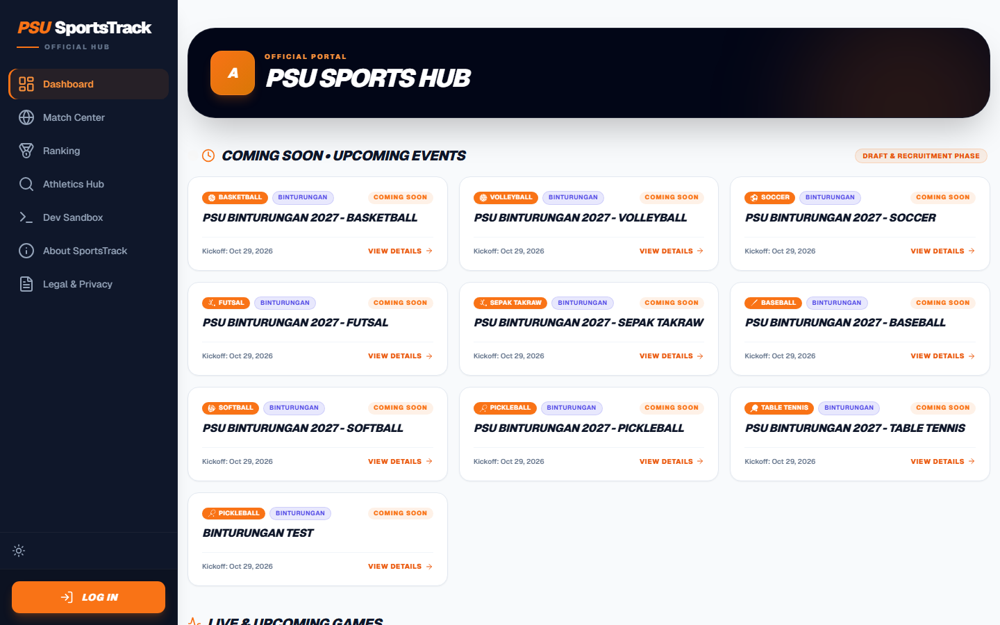 | 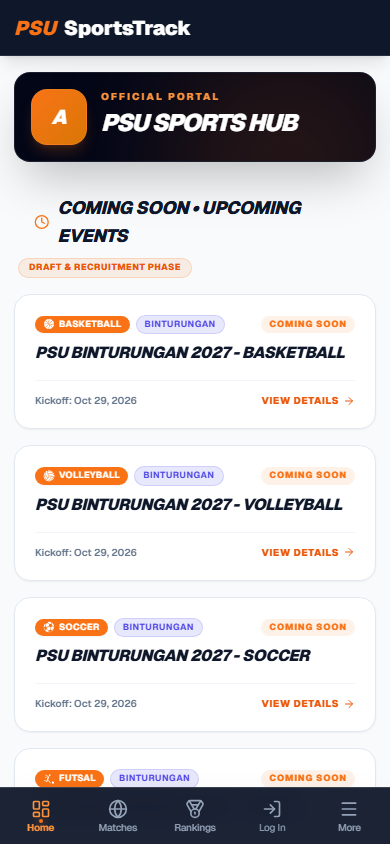 |
* **Figure 1.1**: Public Portal Home Dashboard — (Left: Full widescreen layout with live match ticker; Right: Mobile vertical stack).

---

### 2. Tournament & Match Explorer (`/explorer`)
*Comprehensive elimination bracket center, stage filtering (Quarterfinals, Semifinals, Finals), and symmetric glassmorphic DataToolbar.*

| Desktop View (1440×900) | Mobile View (390×844) |
|---|---|
| 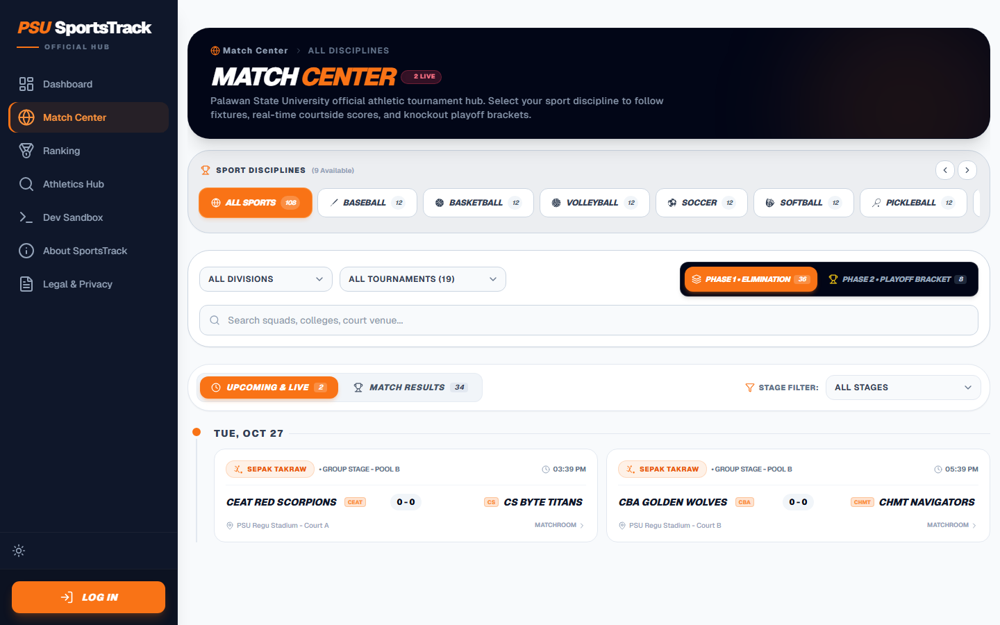 | 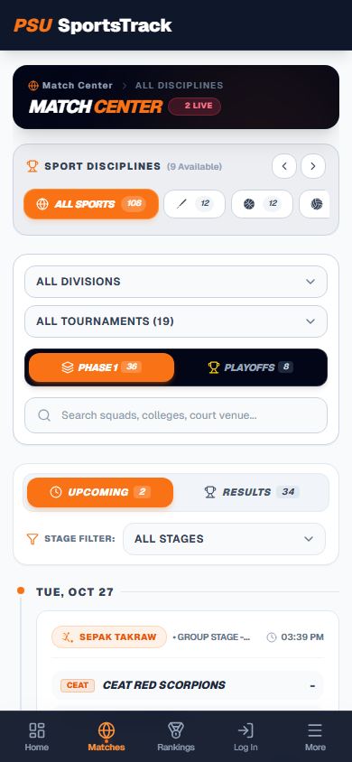 |
* **Figure 2.1**: Tournament & Match Explorer — (Left: Desktop bracket filter matrix; Right: Responsive mobile card feed).

---

### 3. Rankings & Medal Standings Tally (`/ranking`)
*University-wide collegiate cluster medal leaderboard (Gold, Silver, Bronze), overall championship points, and rank breakdown.*

| Desktop View (1440×900) | Mobile View (390×844) |
|---|---|
| 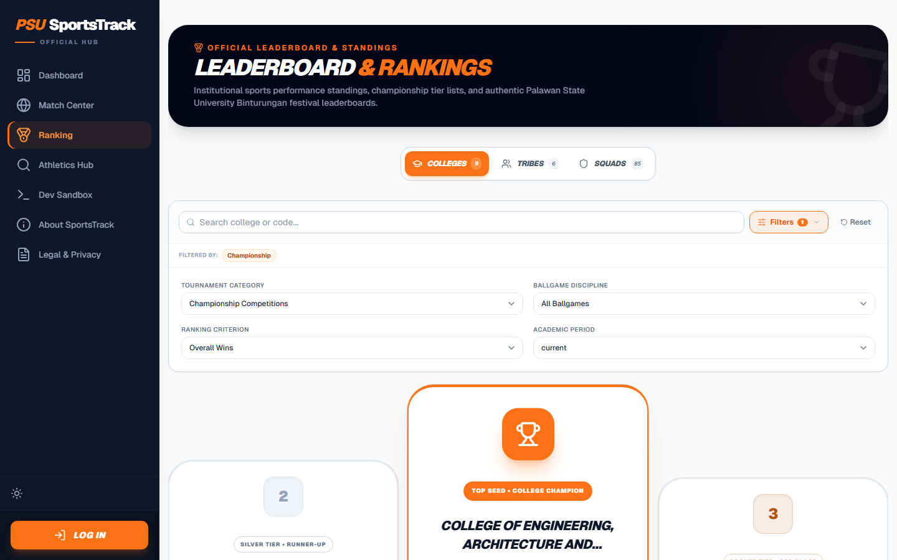 | 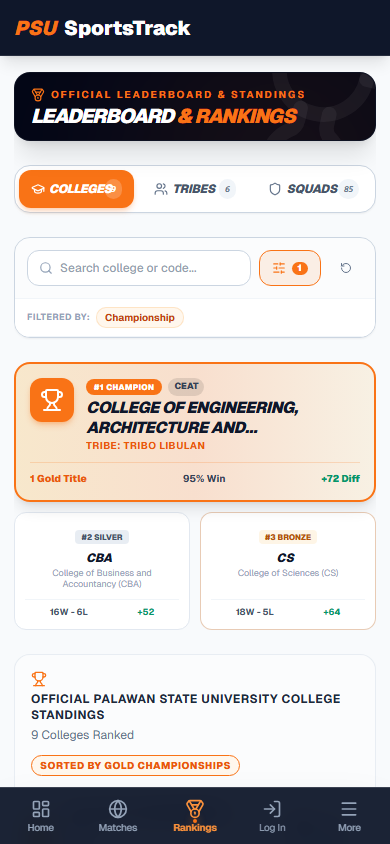 |
* **Figure 3.1**: University Medal Standing Leaderboard — (Left: Multi-column cluster ranking table; Right: Compact mobile podium card list).

---

### 4. Athletics & Scouting Hub (`/athletics`)
*Public athlete directory, varsity statistical radar profiles, top scoring performers, and MVP race rankings.*

| Desktop View (1440×900) | Mobile View (390×844) |
|---|---|
| 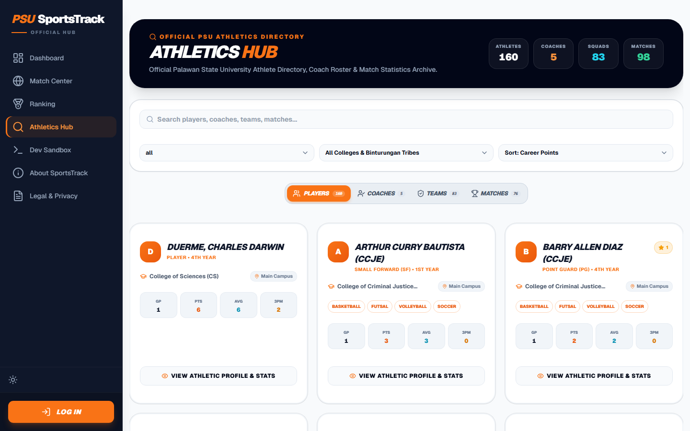 | 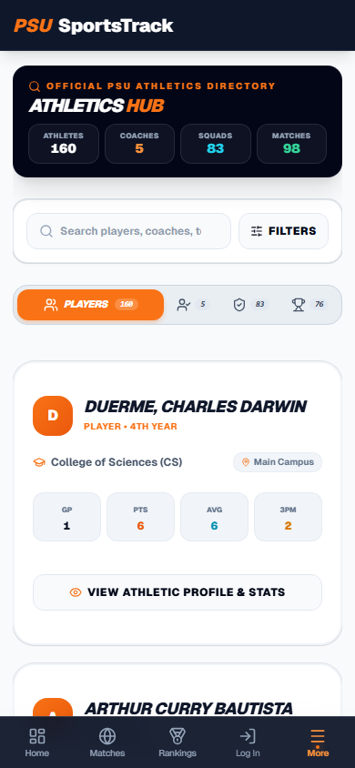 |
* **Figure 4.1**: Athletics & Varsity Scouting Center — (Left: Desktop grid with statistical cards; Right: Mobile swipeable athlete list).

---

### 5. Legal, Privacy & Terms of Service (`/legal`)
*Compliance portal implementing Republic Act 10173 (Data Privacy Act of 2012), university guidelines, sequential read tracking, and PDF export.*

| Desktop View (1440×900) | Mobile View (390×844) |
|---|---|
|  | 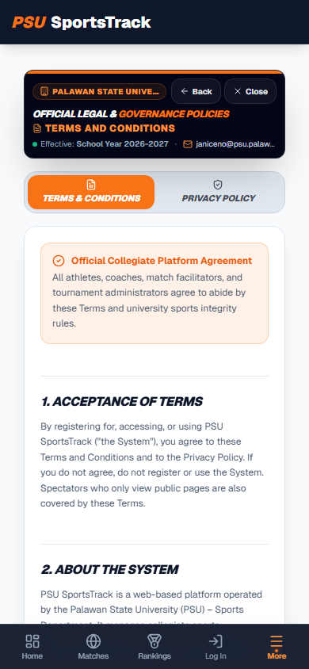 |
* **Figure 5.1**: University Legal & Data Privacy Reader — (Left: Desktop dual-column policy reader; Right: Mobile single-column reader).

---

### 6. Authentication & Rate-Limited Access (`/?login=true`)
*Glassmorphic authentication modal with brute-force rate-limiting indicators, PSU institutional email validation, and role redirection.*

| Desktop View (1440×900) | Mobile View (390×844) |
|---|---|
|  |  |
* **Figure 6.1**: Secure Multi-Role Authentication Modal — (Left: Desktop glassmorphic dialog; Right: Mobile bottom sheet touch dialog).

---

### 7. Athlete & Faculty Onboarding (`/register`)
*Role-adaptive registration capturing student numbers, faculty/employee IDs, college clusters, and mandatory legal consent.*

| Desktop View (1440×900) | Mobile View (390×844) |
|---|---|
| 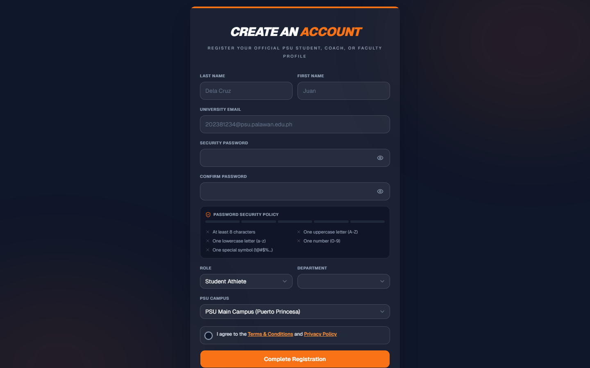 | 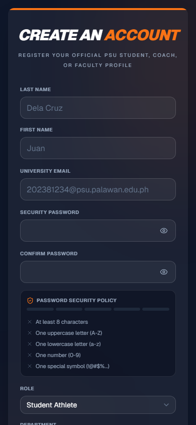 |
* **Figure 7.1**: Athlete & Personnel Registration Portal — (Left: Desktop form; Right: Mobile form).

---

### 8. Live Matchroom & Commentary Center (`/match/:id`)
*Real-time courtside matchroom displaying quarter/set score progress, team fouls, shot charts, and live event log commentary.*

| Desktop View (1440×900) | Mobile View (390×844) |
|---|---|
| 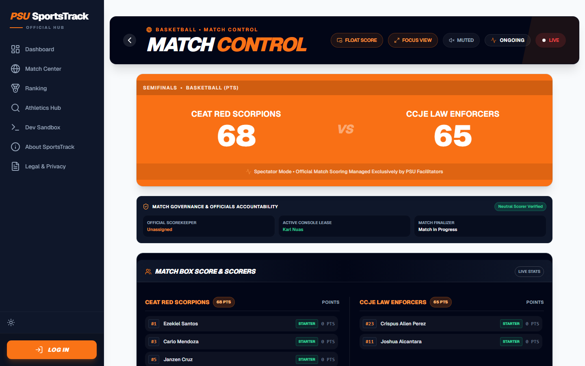 | 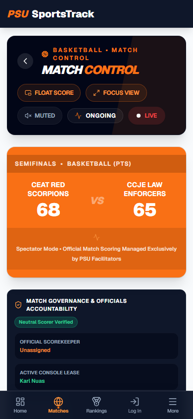 |
* **Figure 8.1**: Live Match Center & Play-by-Play Commentary — (Left: Desktop scoreboard and split stream; Right: Mobile vertical stack).

---

### 9. Courtside Facilitator Scoring Kiosk (`/match/:id/kiosk`)
*Dedicated courtside operator scoring deck with one-tap scoring (+1, +2, +3), timeout triggers, foul logging, and offline sync resilience.*

| Desktop View (1440×900) | Mobile View (390×844) |
|---|---|
|  | 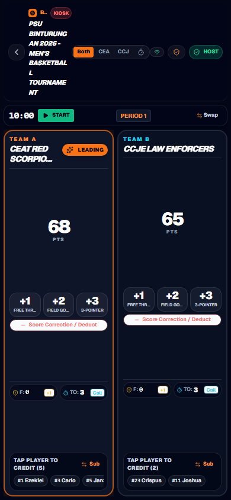 |
* **Figure 9.1**: Courtside Facilitator Scoring Kiosk — (Left: Desktop courtside console; Right: Mobile/Tablet quick touch scoring deck).

---

### 10. Arena Stadium Jumbotron Display (`/match/:id/display`)
*High-contrast edge-to-edge arena jumbotron display optimized for gym/stadium projectors and broadcast displays.*

| Desktop Arena View (1920×1080) | Mobile / Landscape View (844×390) |
|---|---|
|  |  |
* **Figure 10.1**: Stadium Arena Jumbotron Display — (Full widescreen arena projector mode with giant game clock and score counters).

---

### 11. Administrative Command Center (`/admin`)
*USDO administrative control center providing quick-stat summaries, clearance approval counts, active tournament statuses, and navigation shortcuts.*

| Desktop View (1440×900) | Mobile View (390×844) |
|---|---|
| 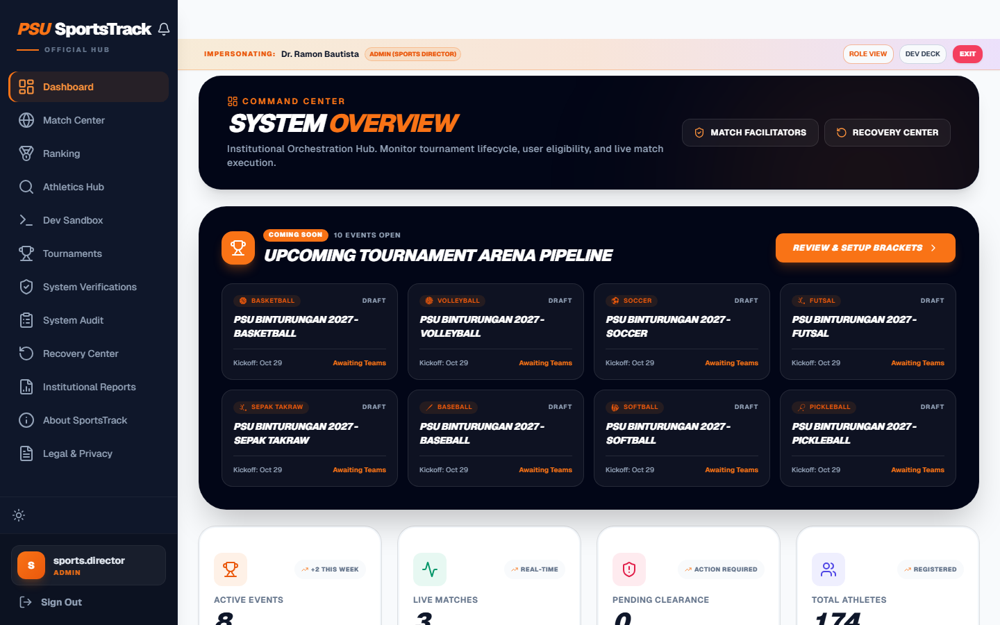 | 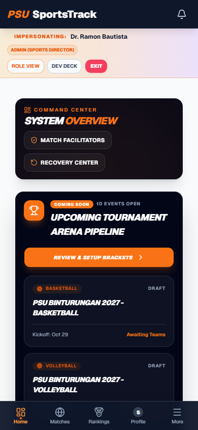 |
* **Figure 11.1**: Administrative Command Center — (Left: Multi-metric dashboard; Right: Mobile responsive admin cards).

---

### 12. Tournament Operations & Bracket Generator (`/admin/tournaments`)
*Tournament configuration suite: Single and double elimination bracket generator, schedule builder, and sport venue assignment.*

| Desktop View (1440×900) | Mobile View (390×844) |
|---|---|
|  | 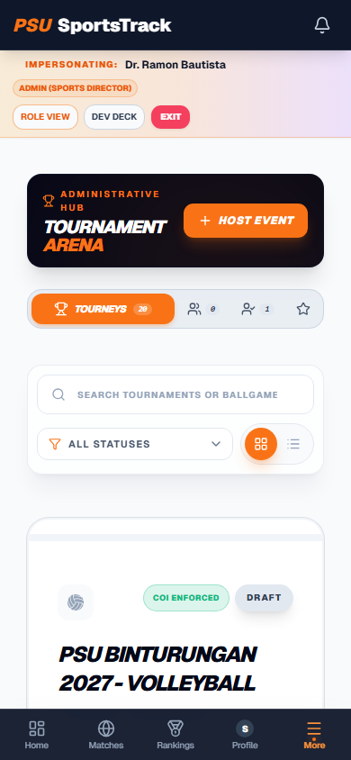 |
* **Figure 12.1**: Tournament Management & Bracket Generator — (Left: Desktop bracket editor; Right: Mobile tournament operations view).

---

### 13. Courtside Facilitator Operations Hub (`/admin/tournaments` - Officials)
*Match official scheduling board, candidate recruitment drawer, and round-by-round scorekeeper assignments.*

| Desktop View (1440×900) | Mobile View (390×844) |
|---|---|
| 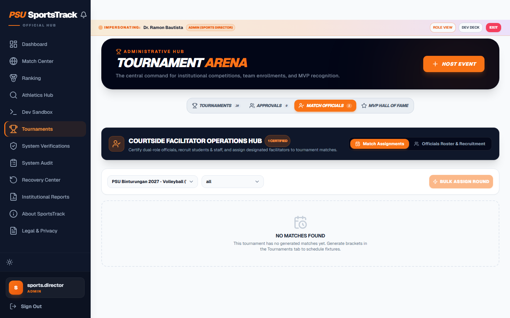 | 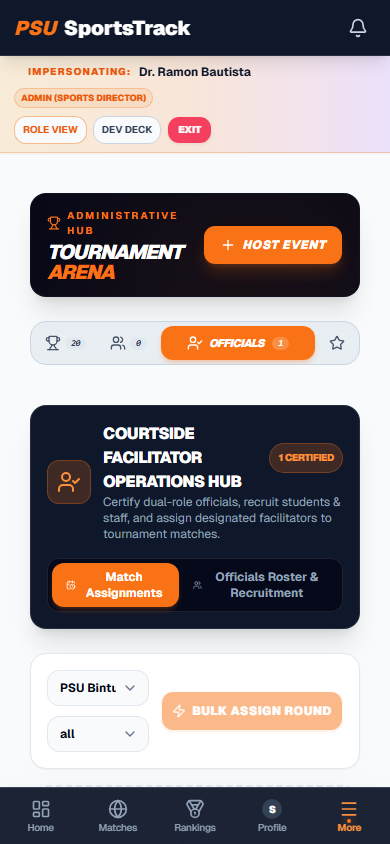 |
* **Figure 13.1**: Facilitator Operations Hub & Assignment Board — (Left: Desktop assignment table; Right: Mobile official list).

---

### 14. Document Clearance & Eligibility Queue (`/admin/verifications`)
*Athlete eligibility review deck with split-pane PDF/image document inspection for student CORs, employee IDs, and medical clearances.*

| Desktop View (1440×900) | Mobile View (390×844) |
|---|---|
| 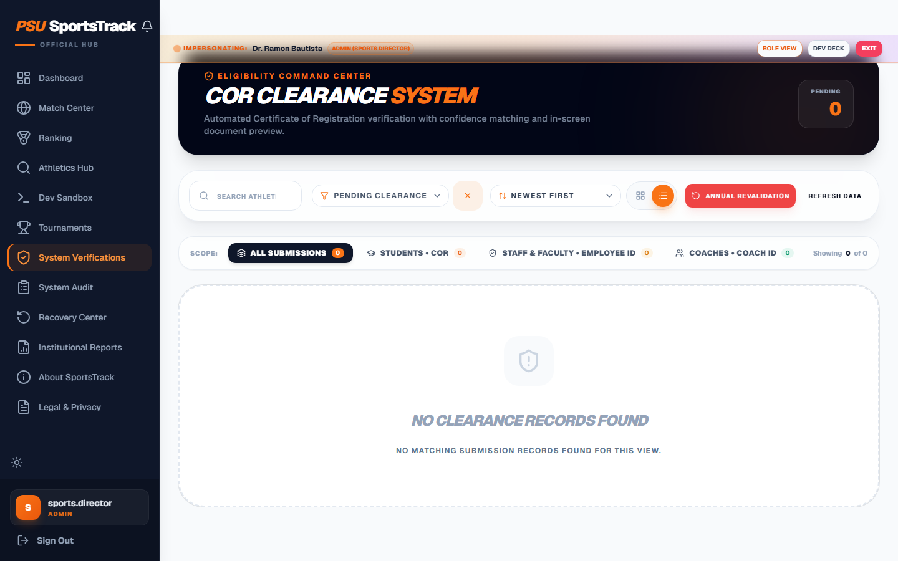 | 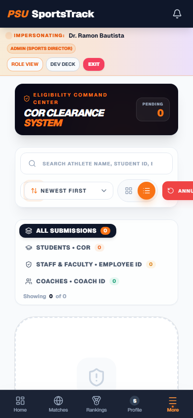 |
* **Figure 14.1**: Athlete Eligibility Verification Queue — (Left: Desktop document review pane; Right: Mobile clearance card list).

---

### 15. Institutional Audit Logs (`/admin/audit-logs`)
*Immutable event ledger logging administrative actions, score dispute adjustments, user role promotions, and system logins.*

| Desktop View (1440×900) | Mobile View (390×844) |
|---|---|
| 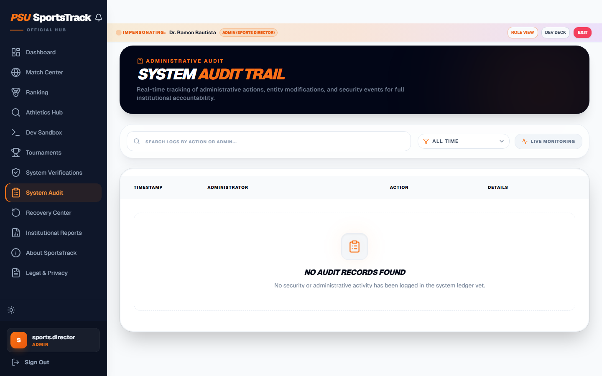 | 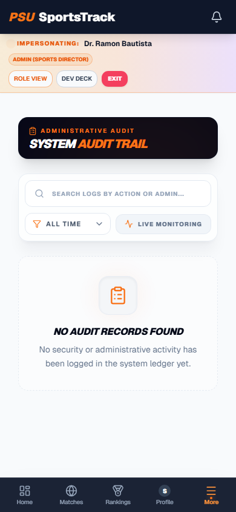 |
* **Figure 15.1**: Institutional Audit Trail & Activity Log — (Left: Desktop filterable event log; Right: Mobile timeline feed).

---

### 16. Institutional Reports & Statistical Exports (`/admin/reports`)
*University tournament reporting center generating official medal tallies, match result summaries, and printable PDF documents.*

| Desktop View (1440×900) | Mobile View (390×844) |
|---|---|
| 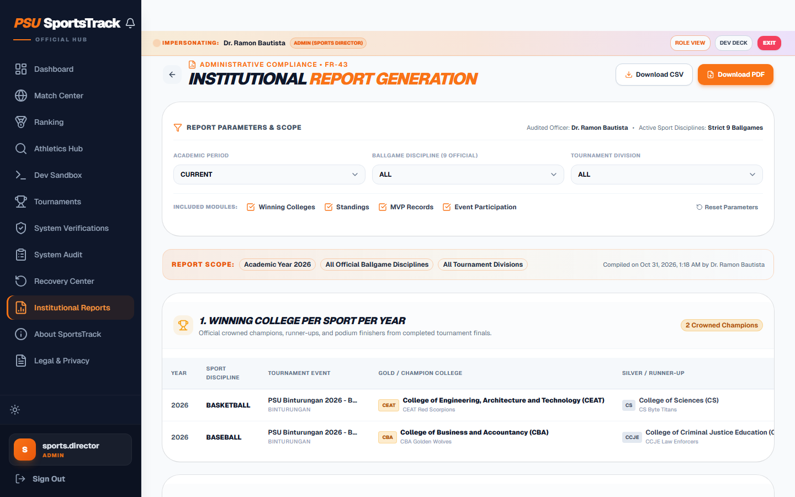 | 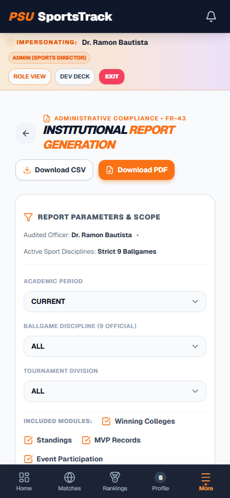 |
* **Figure 16.1**: Institutional Reporting & Export Suite — (Left: Desktop report generator; Right: Mobile export launcher).

---

### 17. Coach Team & Squad Management (`/coach/teams`)
*Collegiate team management deck for coaches: Squad roster, uniform jersey numbering, starters vs bench rotation, and player eligibility status.*

| Desktop View (1440×900) | Mobile View (390×844) |
|---|---|
|  | 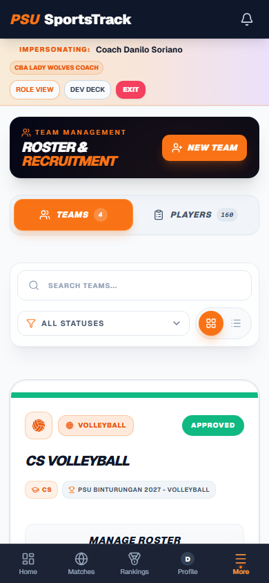 |
* **Figure 17.1**: Collegiate Coach Squad Management — (Left: Desktop team lineup builder; Right: Mobile athlete cards).

---

### 18. Verified Athlete Profile (`/profile`)
*Personal athlete passport displaying university clearance status, college cluster affiliations, tournament history, and achievement badges.*

| Desktop View (1440×900) | Mobile View (390×844) |
|---|---|
| 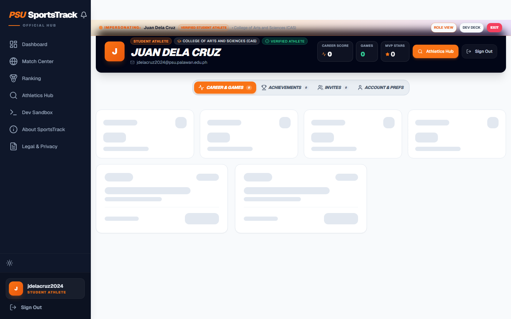 | 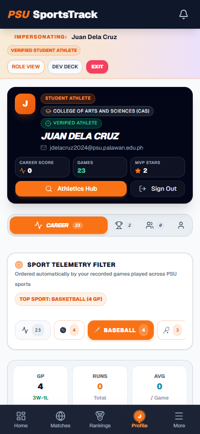 |
* **Figure 18.1**: Verified Athlete Profile & Clearance Card — (Left: Desktop profile layout; Right: Mobile profile overview).
